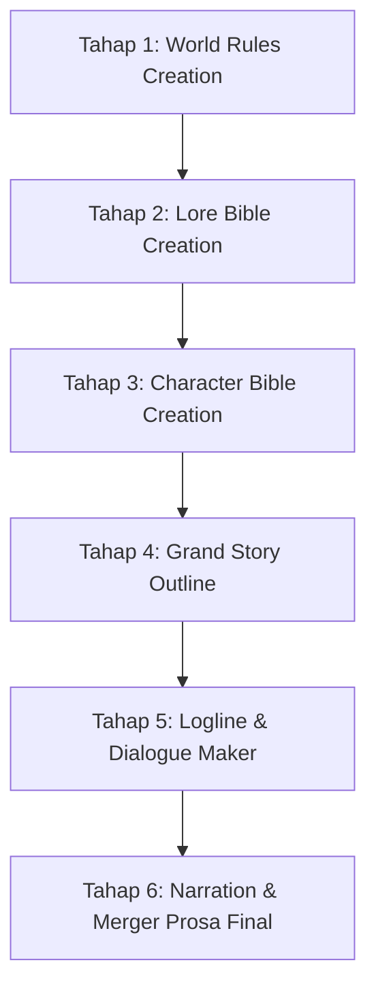

# duidwidev-novel: Sistem Penulisan Novel Slowburn & Worldbuilding

Sistem terpadu pembuatan novel serial slowburn dari fondasi semesta hingga naskah prosa final, dikembangkan oleh **duidwidev**. Sistem ini dirancang untuk menghasilkan narasi yang runtut, kaya gestur mikro, bebas *AI-slop*, serta memberikan kendali penuh kepada pengguna di setiap tahap.

---

## 🗺️ Peta Alur Kerja 6 Tahap (Master Pipeline)



Panduan lengkap alur kerja master dapat dirujuk pada: [master_workflow.md](./references/master_workflow.md).

---

## 🚀 Alur Eksekusi Tahap demi Tahap (Step-by-Step Instructions)

### 🏛️ TAHAP 1: World Rules Creation (Aturan Dasar Semesta)
1. **Konfirmasi Basis Semesta:** Tanyakan kepada user apakah dunianya:
   - *Full Real-Life* (Dunia nyata murni 100%).
   - *Semi-Real Life + Fiksi* (Dunia nyata dengan 1-2 variabel fiksi/anomali).
   - *Full Fictional RPG World* (Semesta fiksi penuh dengan ras, sihir, kelas, dan guild).
2. **Definisikan 5 Pilar Semesta:**
   - Struktur ras & friksi sosial (fisiologi, diskriminasi pekerjaan/penginapan, variasi regional).
   - Sistem energi mana internal & teknologi baterai batu mana.
   - Sistem lisensi 3 kelas (*Vanguard, Spellcaster, Striker*) dan ujian resmi S1.
   - Ekonomi guild (isu *oversupply* petualang yang menekan harga quest).
   - Ekologi monster (*Utility vs Dangerous vs Crisis vs Protected*).
3. **Dokumentasi & Template:**
   - Panduan: [world_rules_framework.md](./references/world_rules_framework.md)
   - Template: [world_rules_template.md](./resources/world_rules_template.md)
   - Evaluasi: [world_rules_evaluation.md](./evaluations/world_rules_evaluation.md)

---

### 📜 TAHAP 2: Lore Bible Creation (Kanon Spesifikasi Dunia & Kurasi)
1. **Aturan Mutlak Kurasi User (*User Curation Gate*):** DILARANG menambahkan item, tempat, atau aturan baru tanpa persetujuan eksplisit user.
2. **Konvensi Penamaan Otentik (Anti-Generic Compound Words):**
   - ❌ *Dilarang:* Nama generik gabungan kata (*Eastview Horizon, Blackclaw Monster*).
   - ✅ *Wajib:* Nama 1 kata unik / Latin-root (*seperti 'Irthiniris', 'Valdris', 'Morvath'*).
3. **Pencatatan Spesifikasi Konkret:**
   - Item/Artefak, Entitas/Makhluk, Rules/Hukum Alam, Tempat/Environment, Relasi Faksi, dan Sejarah.
4. **Dokumentasi & Template:**
   - Panduan: [lore_bible_guide.md](./references/lore_bible_guide.md)
   - Template: [lore_bible_template.md](./resources/lore_bible_template.md)
   - Evaluasi: [lore_bible_evaluation.md](./evaluations/lore_bible_evaluation.md)

---

### 👤 TAHAP 3: Character Bible Creation (Master Branding Karakter)
1. **Wawancara Interaktif (Multi-Choice):** Agent wajib aktif menawarkan opsi-opsi terkurasi kepada user saat menggali detail karakter.
2. **Rancang 6 Pilar Branding Super-Kuat:**
   - *Iconic Lines:* Gaya tutur khas non-cringe dan tidak repetitif.
   - *Iconic Behaviour:* Gestur mikro bawah sadar saat berpikir atau cemas.
   - *Visual Anchor / Wears:* Siluet fisik atau benda khas yang melekat.
   - *Responses to Triggers & Trauma:* Reaksi emosional berakar memori masa lalu.
   - *Dynamic Motivation:* Tujuan jangka pendek dan jangka panjang yang berkembang.
   - *Moral Compass:* Batas moral yang pantang dilanggar (*red lines*).
3. **Audit Keselarasan Lore:** Validasi ras, afinitas sihir, dan status faksi terhadap Lore Bible.
4. **Dokumentasi & Template:**
   - Panduan: [character_bible_guide.md](./references/character_bible_guide.md)
   - Template: [character_bible_template.md](./resources/character_bible_template.md)
   - Evaluasi: [character_bible_evaluation.md](./evaluations/character_bible_evaluation.md)

---

### 🗺️ TAHAP 4: Story Outline Creation (Grand Story Roadmap)
1. **Sintesis 3 Pilar:** Padukan motivasi karakter (*Character Bible*), panggung dunia (*Lore Bible*), dan rintangan sistem (*World Rules*).
2. **Petakan Alur Awal s/d Akhir Cerita:**
   - Babak 1 (Setup), Babak 2 (World Friction), Babak 3 (Crisis), Babak 4 (Resolution).
3. **Bagi 5 Milestones Wajib per Bab:**
   - *Milestone A (Opening) -> Milestone B (Inciting Shift) -> Milestone C (Escalation) -> Milestone D (Climax) -> Milestone E (Ending Hook)*.
4. **Dokumentasi & Template:**
   - Panduan: [story_outline_guide.md](./references/story_outline_guide.md)
   - Template: [story_outline_template.md](./resources/story_outline_template.md)
   - Evaluasi: [outline_evaluation.md](./evaluations/outline_evaluation.md)

---

### 🎬 TAHAP 5: Logline & Dialogue Maker (Mikro-Beat per Bab)
1. **Kendali Penuh User:** User memilih bab mana yang ingin dibuat (misal: Bab 1) dan menentukan tingkat kedalaman (misal: 60 beat atau 100+ beat slowburn).
2. **Format Standar Beat:**
   ```text
   mood : [TOKEN_MOOD], place : [LOKASI]
   [Nomor]. [Kalimat aksi fisik / gestur / interaksi konkret yang jelas dan bebas slop]
   ```
3. **8 Token Mood Baku:** `CALM`, `WARMTH`, `UNEASE`, `TENSE`, `PANIC`, `RELIEF`, `MELANCHOLY`, `TRIUMPH`.
4. **Audit Anomali Emosi (Anti-Whiplash):**
   - 🚨 *Sandwich Anomaly Dilarang:* `TENSE -> HAPPY -> TENSE` tanpa alasan logis langsung dibatalkan.
5. **Sisipkan Dialog Luwes:**
   - Fleksibilitas kuantitas: beat murni aksi (0 dialog), dialog 1 baris, atau multi-dialog saut-sautan basa-basi alami.
   - Pemanfaatan celotehan santai (*meaningful small talk*) dan bahasa non-verbal naga/makhluk.
6. **Dokumentasi & Template:**
   - Panduan: [logline_system.md](./references/logline_system.md) & [dialogue_system.md](./references/dialogue_system.md)
   - Audit: [outline_direction_audit.md](./references/outline_direction_audit.md) & [character_and_lore_audit.md](./references/character_and_lore_audit.md)
   - Template: [dialogue_beat_template.md](./resources/dialogue_beat_template.md)
   - Evaluasi: [dialogue_evaluation.md](./evaluations/dialogue_evaluation.md)

---

### ✍️ TAHAP 6: Narration & Merger (Prosa Novel Final - Modular per Bab)
1. **Penggabungan Organik:** Menggabungkan aksi logline, dialog, dan dialog tag menjadi alinea novel utuh. Eksekusi dapat dilakukan bab per bab sesuai permintaan user.
2. **Filter Bahasa & Anti-AI Slop Ketat:**
   - **Bahasa Lugas & Jelas:** Tanpa *sugar-coating* dan tanpa metafora puitis berlebihan (*zero purple prose*).
   - **Bebas Kata Arkais / Tidak Lazim:** Hindari kata kerja sastra berat (*menderai, meruyak, menelikung, melingkupi kalbu*); gunakan kata kerja wajar sehari-hari (*membuka, melirik, mengelus, mendengus, melangkah, menarik, menoleh*).
3. **Dokumentasi & Template:**
   - Panduan: [narration_merger_guide.md](./references/narration_merger_guide.md)
   - Template: [prose_merger_template.md](./resources/prose_merger_template.md)
   - Evaluasi: [narration_evaluation.md](./evaluations/narration_evaluation.md)

---

## 🛡️ 5 Golden Rules duidwidev-novel

1. **User Curation Gate:** Wajib meminta izin user sebelum mendaftarkan karakter bernama baru atau entri Lore Bible kanon.
2. **Authentic Naming:** Selalu gunakan nama distingtif 1 kata / Latin-root (*Irthiniris*), bukan nama generik gabungan kata (*Eastview/Blackclaw*).
3. **Plain & Grounded Diction:** Deskripsi fokus pada aksi fisik nyata dan fakta lingkungan tanpa kata-kata *fancy* kosong atau puitis berlebihan.
4. **Meaningful Small Talk:** Basa-basi santai adalah kebutuhan nyata untuk memperkuat *bonding & chemistry* karakter.
5. **Modular Chapter-by-Chapter Execution:** Logline dan narasi prosa dieksekusi bab per bab secara bertahap sesuai kendali penuh user.
