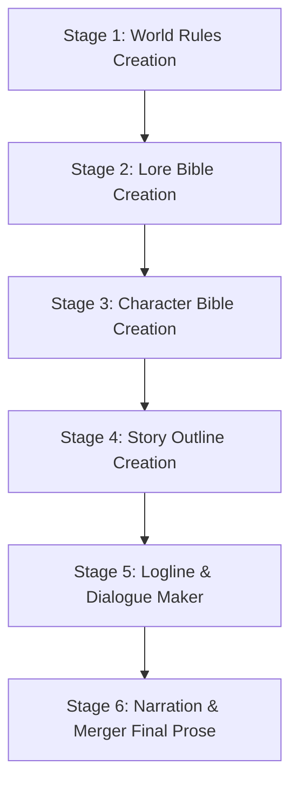

# duidwidev-novel: Serialized Novel & Slowburn Worldbuilding System

An integrated system for writing serialized slowburn novels from foundational world mechanics to finished prose manuscripts, created by **duidwidev**. This framework is engineered to deliver grounded, micro-gesture-rich narratives free of AI slop, granting the user full modular control at every stage.

---

## 🗺️ Master Pipeline (6 Sequential Stages)



Full master workflow documentation: [master_workflow.md](./references/master_workflow.md).

---

## 🚀 Step-by-Step Execution Protocol

### 🏛️ STAGE 1: World Rules Creation (Universal Mechanics)
1. **Confirm World Baseline:** Ask the user whether their setting is:
   - *Full Real-Life* (100% real-world physics and sociology).
   - *Semi-Real Life + Fiction* (Real world with 1-2 fictional variables).
   - *Full Fictional RPG World* (Complete universe with magic, races, classes, and guilds).
2. **Define the 5 Core System Pillars:**
   - Racial structures & social tensions (e.g. Human vs. Beastmen physiology and regional policies).
   - Biological internal mana & external mana-battery storage technology.
   - 3 Class archetypes (*Vanguard, Spellcaster, Striker*) and academic-level S1 licensing exams.
   - Guild labor economics (oversupply of adventurers driving down quest payouts).
   - Monster ecology and threat matrices (*Utility vs. Dangerous vs. Crisis vs. Protected*).
3. **Documentation & Resources:**
   - Guide: [world_rules_framework.md](./references/world_rules_framework.md)
   - Template: [world_rules_template.md](./resources/world_rules_template.md)
   - Evaluation: [world_rules_evaluation.md](./evaluations/world_rules_evaluation.md)

---

### 📜 STAGE 2: Lore Bible Creation (Curated Canon)
1. **Mandatory User Curation Gate:** Strictly PROHIBITED from adding new items, places, or rules without explicit user approval.
2. **Authentic Naming Conventions (Anti-Generic Compound Words):**
   - ❌ *Banned:* Cliché compound phrases (*Eastview Horizon, Blackclaw Monster*).
   - ✅ *Enforce:* Distinctive 1-word / Latin-root names (*'Irthiniris', 'Valdris', 'Morvath'*).
3. **Concrete Specifications:** Record tangible functions, hard limits, and usage costs.
4. **Documentation & Resources:**
   - Guide: [lore_bible_guide.md](./references/lore_bible_guide.md)
   - Template: [lore_bible_template.md](./resources/lore_bible_template.md)
   - Evaluation: [lore_bible_evaluation.md](./evaluations/lore_bible_evaluation.md)

---

### 👤 STAGE 3: Character Bible Creation (Master Branding)
1. **Interactive Multi-Choice Interviews:** Proactively offer curated options when fleshing out characters.
2. **Structure the 6 Core Branding Pillars:**
   - *Iconic Lines:* Distinct vocal cadence free of cringe, forced catchphrases.
   - *Iconic Behaviour:* Subconscious physical micro-habits when thinking or stressed.
   - *Visual Anchor / Wears:* Distinct physical trait, relic, or silhouette.
   - *Dynamic Triggers & Trauma:* Emotional reactions rooted in specific backstory memories.
   - *Dynamic Motivation:* Short-term goals and ultimate desires that evolve over time.
   - *Moral Compass:* Absolute red lines that will never be crossed.
3. **Lore Compatibility Audit:** Ensure 100% alignment with the Lore Bible.
4. **Documentation & Resources:**
   - Guide: [character_bible_guide.md](./references/character_bible_guide.md)
   - Template: [character_bible_template.md](./resources/character_bible_template.md)
   - Evaluation: [character_bible_evaluation.md](./evaluations/character_bible_evaluation.md)

---

### 🗺️ STAGE 4: Story Outline Creation (Grand Narrative Roadmap)
1. **3-Pillar Synthesis:** Combine character drives, lore settings, and world rule frictions.
2. **Map the Full Story Arc:** 4 Narrative Acts (Setup, World Friction, Crisis, Resolution).
3. **Structure 5 Mandatory Milestones per Chapter:**
   - *Milestone A (Opening) -> Milestone B (Inciting Shift) -> Milestone C (Escalation) -> Milestone D (Climax) -> Milestone E (Ending Hook)*.
4. **Documentation & Resources:**
   - Guide: [story_outline_guide.md](./references/story_outline_guide.md)
   - Template: [story_outline_template.md](./resources/story_outline_template.md)
   - Evaluation: [outline_evaluation.md](./evaluations/outline_evaluation.md)

---

### 🎬 STAGE 5: Logline & Dialogue Drafting (Chapter-by-Chapter)
1. **User Control:** The user selects the chapter and specifies granularity (e.g. 60 or 100+ slowburn beats).
2. **Standard Beat Syntax:**
   ```text
   mood : [MOOD_TOKEN], place : [LOCATION]
   [Number]. [Concrete physical action / gesture / environmental interaction sentence]
   ```
3. **8 Standardized Mood Tokens:** `CALM`, `WARMTH`, `UNEASE`, `TENSE`, `PANIC`, `RELIEF`, `MELANCHOLY`, `TRIUMPH`.
4. **Anti-Mood Whiplash Audit:** Prohibit the *Sandwich Anomaly* (`TENSE -> HAPPY -> TENSE`).
5. **Fluid Dialogue Integration:**
   - Frequency flexibility: 0-dialogue beats, single lines, or multi-line natural banter.
   - Incorporate meaningful small talk and creature non-verbal lines.
6. **Documentation & Resources:**
   - Guides: [logline_system.md](./references/logline_system.md) & [dialogue_system.md](./references/dialogue_system.md)
   - Audits: [outline_direction_audit.md](./references/outline_direction_audit.md) & [character_and_lore_audit.md](./references/character_and_lore_audit.md)
   - Template: [dialogue_beat_template.md](./resources/dialogue_beat_template.md)
   - Evaluation: [dialogue_evaluation.md](./evaluations/dialogue_evaluation.md)

---

### ✍️ STAGE 6: Narration & Merger (Final Prose - Modular per Chapter)
1. **Organic Fusion:** Merge logline actions, spoken lines, and speech tags into dynamic novel paragraphs.
2. **Strict Plain Diction & Anti-Slop Filter:**
   - **Plain & Grounded Language:** Zero purple prose, zero sugar-coating.
   - **Zero Archaic / Obscure Verbs:** Use natural everyday verbs (*opened, glanced, stroked, snorted, stepped, pulled, held, turned*).
3. **Documentation & Resources:**
   - Guide: [narration_merger_guide.md](./references/narration_merger_guide.md)
   - Template: [prose_merger_template.md](./resources/prose_merger_template.md)
   - Evaluation: [narration_evaluation.md](./evaluations/narration_evaluation.md)

---

## 🛡️ The 5 Golden Rules of duidwidev-novel

1. **User Curation Gate:** Always obtain user confirmation before adding named characters or canonizing lore.
2. **Authentic Naming:** Enforce distinct 1-word / Latin-root names (*Irthiniris*); ban generic compound words (*Eastview/Blackclaw*).
3. **Plain & Grounded Diction:** Focus on physical reality without empty fancy words or purple prose.
4. **Meaningful Small Talk:** Casual character banter is an essential requirement for believable chemistry.
5. **Modular Chapter-by-Chapter Execution:** Loglines and prose conversion can be executed modularly chapter by chapter.
