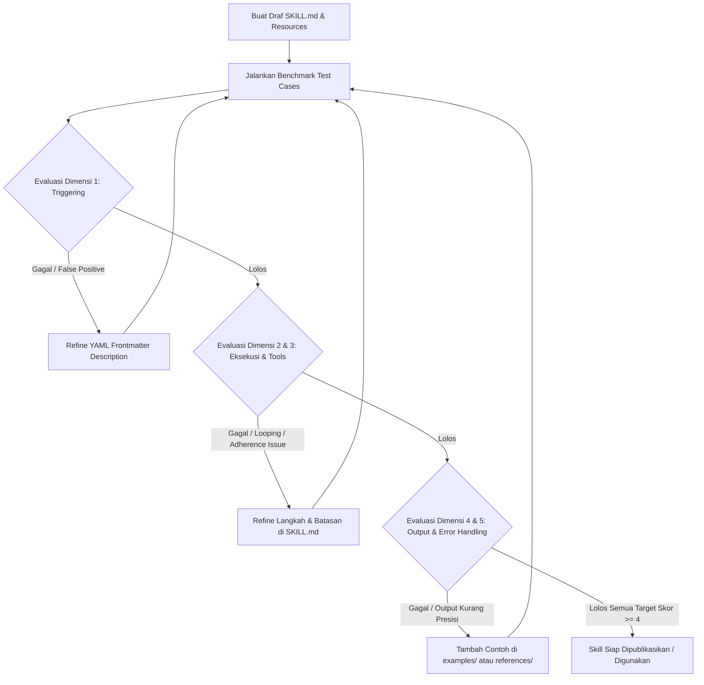

# Framework & Standar Evaluasi Skill (Antigravity IDE / Gemini Agent)

Dokumen ini berisi panduan, metrik penilaian, dan framework pengujian untuk mengevaluasi kualitas dan keandalan Custom Skill sebelum dan sesudah diimplementasikan.

---

## 1. Arsitektur & Standar Skill Antigravity

Struktur resmi skill Antigravity:
```text
skills/<skill-name>/
├── SKILL.md          # [WAJIB] Instruksi utama & Frontmatter YAML
├── scripts/          # [OPSIONAL] Helper script eksekusi (Python, Shell, Lua, dll.)
├── examples/         # [OPSIONAL] Contoh implementasi input/output nyata
├── resources/        # [OPSIONAL] Asset, data statis, atau template
└── references/       # [OPSIONAL] Dokumentasi mendalam (progressive disclosure)
```

### Prinsip Utama Penulisan Skill:
1. **Progressive Disclosure:** File utama `SKILL.md` harus padat dan terstruktur. Detail dokumen panjang ditaruh di folder `references/` dan di-link dengan relative path agar tidak membebani context window saat skill aktif.
2. **Deterministic Activation:** Deskripsi frontmatter (`description`) harus spesifik menyatakan **kapan** dan **dalam kondisi apa** skill harus digunakan agar agent tidak salah memicu (*false trigger*).
3. **Actionable Steps with Verification:** Setiap instruksi wajib menyertakan verifikasi eksplisit (contoh: cara mengecek output, run command verifikasi, atau schema assertion).

---

## 2. Metrik Evaluasi Kualitas Skill (Rubrik 5 Dimensi)

Setiap skill dievaluasi menggunakan skala skor 1 - 5 pada 5 dimensi kritis berikut:

| Dimensi Evaluasi | Bobot | Deskripsi | Standar Kelulusan (Min. 4/5) |
| :--- | :---: | :--- | :--- |
| **1. Trigger Precision (Akurasi Pemicu)** | 25% | Agent memanggil skill hanya saat relevan dan tidak memicu pada query acak. | 0 False Positive pada 5 negative tests, 100% aktivasi pada 5 positive tests. |
| **2. Instruction Adherence (Kepatuhan Aturan)** | 25% | Agent mematuhi seluruh batasan negatif (*negative constraints*) dan format tanpa menyimpang. | Mengikuti semua 'DO' dan 'DON'T' tanpa halusinasi format. |
| **3. Tool Usage Efficiency (Efisiensi Tool)** | 20% | Agent memilih tool yang tepat, tidak looping, dan tidak boros token/panggilan berulang. | Jalur eksekusi optimal (shortest valid toolchain). |
| **4. Error Recovery & Edge Cases (Ketahanan Error)** | 15% | Agent menangani kegagalan tool/input ambigu secara graceful tanpa crash/stuck. | Menyediakan fallback terdefinisi saat eksekusi error. |
| **5. Output Quality & Completeness (Kualitas Output)** | 15% | Hasil akhir lengkap, terstruktur rapi, valid secara sintaks/semantik, dan siap pakai. | Output lolos linter/validasi dan menjawab kebutuhan user secara tuntas. |

---

## 3. Rubrik Skor Penilaian (Scoring Matrix)

### Skor 1 (Gagal Kritis):
- Deskripsi skill ambigu, agent tidak pernah terpanggil atau terpanggil di semua prompt acak.
- Instruksi melanggar aturan global atau menghasilkan syntax error.

### Skor 2 (Kurang Memadai):
- Terpanggil secara tidak konsisten (flaky).
- Agent sering melupakan batasan format dan membutuhkan koreksi berulang dari user.

### Skor 3 (Cukup / Marginal):
- Skill berjalan pada happy path, namun gagal ketika ada error minor atau input tidak lengkap.
- `SKILL.md` terlalu panjang (monolitik) sehingga memboroskan token context.

### Skor 4 (Sangat Baik / Production-Ready):
- Deskripsi jelas dengan zero false positive pada benchmark prompt standar.
- Menggunakan progressive disclosure (`references/` & `examples/`).
- Menyertakan langkah verifikasi mandiri bagi agent.

### Skor 5 (Mastery / Flawless):
- Sangat deterministik, penanganan edge-case otomatis, zero unnecessary tool calls, performa token optimal.

---

## 4. Alur Kerja Pengujian (Eval Workflow Protocol)



---

## 5. Checklist Verifikasi Pre-Deployment

- [ ] Frontmatter YAML valid (`name` lowercase-hyphenated, `description` jelas & third-person).
- [ ] Deskripsi menjelaskan *kapan harus pakai* dan *kapan tidak boleh pakai*.
- [ ] File berukuran besar dipisah ke `references/` atau `examples/`.
- [ ] Terdapat langkah verifikasi otomatis bagi agent (e.g. validasi file output, status check).
- [ ] Tidak ada aturan umum duplikatif yang sudah menjadi kapabilitas dasar LLM.
- [ ] Lolos pengujian benchmark pada file `SKILL_TEST_CASES_AND_BENCHMARKS.md`.
