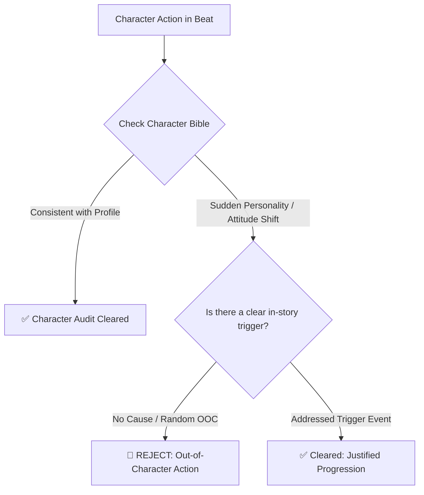
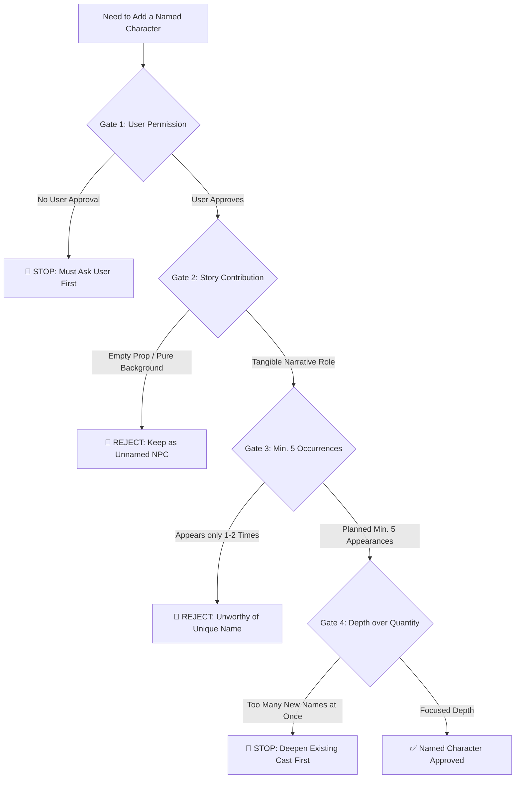

# Character & Lore Bible Audit Protocol

This document defines the evaluation protocols ensuring every beat and scene remains consistent with the **Character Bible** and **Lore Bible** (which are maintained as separate external reference files).

---

## 1. Principle: Separation of Concerns

- **External Reference Files:** Character and Lore Bibles are standalone reference files and must NOT be hardcoded into skill generation.
- **Skill Engine Role:** The skill acts as an evaluator validating whether drafted loglines conform to these external bibles.

---

## 2. Character Integrity & Evolution Audits



### Character Audit Rules:
1. **Anti-OOC (Out of Character) Verification:** Emotional reactions, speech patterns, and habits must reflect the Character Bible profile.
2. **Justified Progression Rule:** Characters *may* evolve in personality, provided changes possess an **explicit in-story trigger that is directly addressed**.

---

## 3. The 5 Mandatory Rules for Adding Named Characters

To prevent character bloat and shallow storytelling, adding a new named character must pass all 5 gates:



### 5 Mandatory Gates:
1. 🛑 **Mandatory User Permission:** The agent is strictly forbidden from inventing named characters without explicit user approval.
2. 📌 **Tangible Contribution:** Must serve a functional or emotional role (even minor characters like a regular shopkeeper).
3. 📌 **Minimum 5 Appearances:** Must have a planned minimum of 5 appearances across the story (can be distant, e.g. early, middle, finale).
4. 📌 **Non-Verbal Characters Allowed:** Mute characters, dragons, companion beasts, or spirits are fully valid as named characters.
5. 📌 **Depth Over Quantity:** Prohibit dumping multiple named characters at once. Deepen the existing cast first.

---

## 4. Standard Proposal Format for Proposing New Characters

```text
[PROPOSED NEW NAMED CHARACTER]
- Character Name : [Name]
- Story Role     : [Functional impact & relationship with protagonist]
- Planned 5x Occurrences:
  1. Scene 1: [Chapter / Situation]
  2. Scene 2: [Chapter / Situation]
  3. Scene 3: [Chapter / Situation]
  4. Scene 4: [Chapter / Situation]
  5. Scene 5: [Chapter / Situation]
- Key Traits     : [Brief description, verbal or non-verbal]

-> Do you approve adding this character to the story?
```
