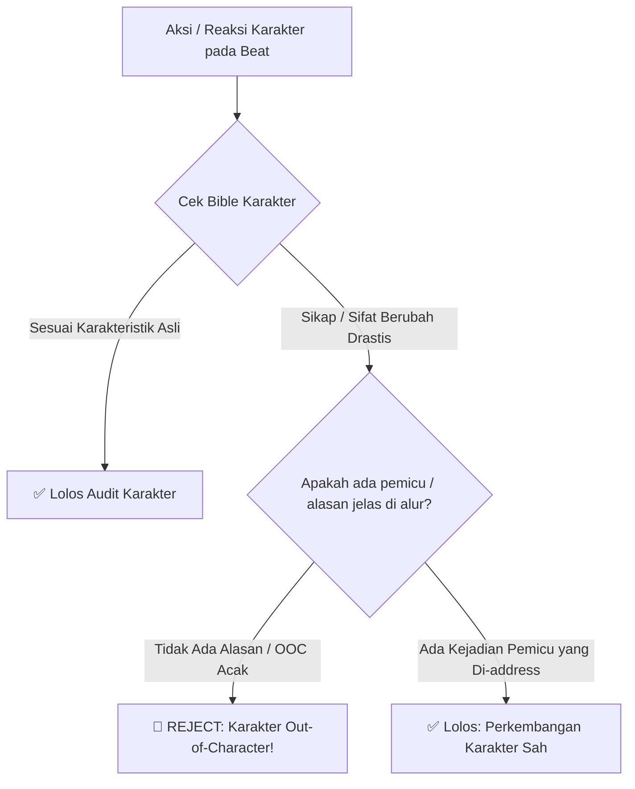
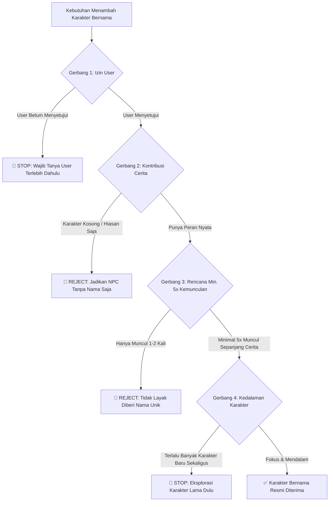

# Standar & Protokol Audit Character & Lore Bible

Dokumen ini mendefinisikan aturan evaluasi dan protokol audit untuk memastikan setiap beat logline maupun draf cerita tetap konsisten dengan **Character Bible** dan **Lore Bible** (yang disimpan secara terpisah sebagai dokumen referensi eksternal).

---

## 1. Prinsip Pemisahan Dokumen (Separation of Concerns)

- **Character Bible & Lore Bible adalah Dokumen Terpisah:** Dokumen bible disimpan di luar skill dan tidak di-generate/di-hardcode langsung ke dalam file skill.
- **Peran Skill:** Skill berfungsi sebagai *engine* yang membaca, mengaudit, dan memvalidasi apakah logline/cerita sesuai dengan bible yang disediakan.

---

## 2. Sistem Audit Karakter (Character Integrity & Evolution)



### Aturan Audit Karakter:
1. **Pemeriksaan Out-of-Character (Anti-OOC):**
   - Respon emosional, gaya bicara, dan kebiasaan karakter harus selalu mencerminkan profil di Character Bible.
2. **Aturan Perubahan Sikap yang Sah (*Justified Progression*):**
   - Karakter **boleh** berubah sikap (misal: dari penakut menjadi berani, dari ceria menjadi dingin, atau membuka diri).
   - **Syarat Wajib:** Perubahan tersebut **harus memiliki alasan pemicu yang jelas dan dialamatkan (*addressed*) secara eksplisit** di dalam peristiwa cerita, bukan terjadi secara mendadak tanpa sebab.

---

## 3. Sistem Audit Dunia & Cerita (Lore & Worldbuilding Integrity)

1. **Konsistensi Hukum Dunia:**
   - Aturan sihir, teknologi, geografi, faksi, dan batasan kekuatan tidak boleh bertentangan dengan Lore Bible.
2. **Ekspansi Lore Bertahap:**
   - Penambahan detail latar dunia baru diperbolehkan selama tidak merevisi fakta yang sudah ditetapkan di bab/lore sebelumnya tanpa alasan logis (*retcon*).

---

## 4. Protokol Penambahan Karakter Bernama Baru (*Named Character Rules*)

Untuk mencegah cerita menjadi dangkal akibat terlalu banyak karakter numpang lewat (*character bloat*), penambahan karakter bernama baru wajib mematuhi 5 gerbang protokol berikut:



### 5 Syarat Wajib Karakter Bernama:

| Gerbang | Syarat | Penjelasan Detail |
| :---: | :--- | :--- |
| **1** | **Wajib Tanya & Minta Izin User** | Agent **DILARANG** menambahkan karakter bernama secara mandiri. Agent wajib mengusulkan dan bertanya kepada user terlebih dahulu sebelum karakter tersebut dimasukkan ke dalam beat logline. |
| **2** | **Kontribusi Nyata terhadap Cerita** | Karakter harus memiliki peran fungsional atau emosional (meskipun peran kecil seperti penjaga toko langganan, pandai besi, atau mata-mata). Tidak boleh sekadar figuran kosong. |
| **3** | **Minimal 5 Kali Kemunculan (*Min. 5 Appearances*)** | Karakter bernama harus direncanakan muncul **minimal 5 kali** di dalam alur cerita. Kemunculan boleh berjarak jauh (misal: muncul di awal bab, di pertengahan, dan di akhir cerita). |
| **4** | **Karakter Non-Verbal Sah** | Karakter **tidak harus bisa berbicara**. Hewan pendamping, naga, monster pelindung, roh bisu, atau golem tetap sah sebagai karakter bernama jika memenuhi syarat lainnya. |
| **5** | **Utamakan Kedalaman (*Depth over Quantity*)** | **Dilarang menambahkan banyak karakter bernama sekaligus dalam satu waktu.** Berikan ruang dan eksplorasi mendalam untuk karakter yang sudah ada sebelum memperkenalkan figur baru. |

---

## 5. Format Standar Mengajukan Karakter Baru ke User

Jika dalam penyusunan logline dirasa membutuhkan karakter bernama baru, gunakan format konfirmasi berikut kepada user:

```text
[USULAN KARAKTER BERNAMA BARU]
- Nama Karakter: [Nama]
- Peran / Kontribusi: [Apa dampaknya terhadap cerita / hubungan dengan MC]
- Rencana Kemunculan (Min. 5x): 
  1. Kemunculan 1: [Bab / Situasi]
  2. Kemunculan 2: [Bab / Situasi]
  3. Kemunculan 3: [Bab / Situasi]
  4. Kemunculan 4: [Bab / Situasi]
  5. Kemunculan 5: [Bab / Situasi]
- Karakteristik / Sifat: [Deskripsi ringkas, verbal atau non-verbal]

-> Apakah Anda menyetujui penambahan karakter ini ke dalam cerita?
```

---

## 6. Checklist Audit Akhir (Pre-Approval Checklist)

- [ ] Aksi setiap karakter selaras dengan profil di Character Bible.
- [ ] Jika ada perubahan perilaku/sikap, alasan dan pemicunya tercatat jelas di dalam peristiwa cerita.
- [ ] Peristiwa cerita tidak menabrak aturan di Lore Bible.
- [ ] Tidak ada karakter bernama baru yang dimasukkan tanpa konfirmasi/izin user.
- [ ] Setiap karakter bernama baru memiliki peran nyata dan komitmen minimal 5 kali kemunculan.
- [ ] Jumlah karakter tetap terkelola tanpa *bloat* (mengutamakan kedalaman karakter yang ada).
