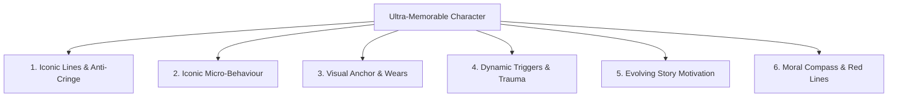
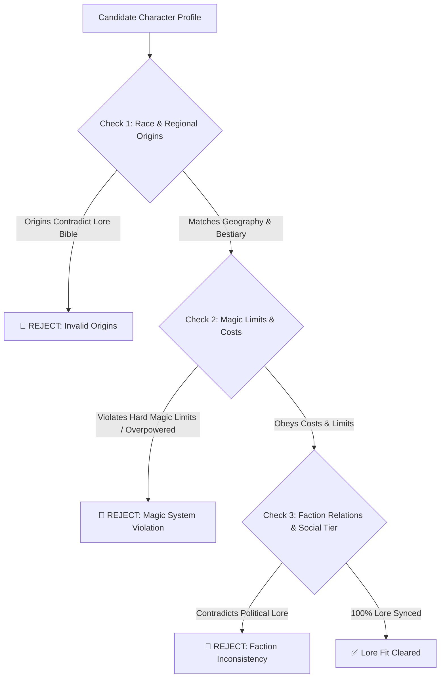

# Character Bible Architecture & Audit Protocol

This document defines the standards for **Ultra-Strong Character Branding**, the **Interactive Multi-Choice Interview Protocol**, and **Lore Bible Alignment Audits**.

---

## 1. Agent Interview Protocol: Guided Multi-Choice Inquiries

When assisting the user in developing a Character Bible, the agent **MUST proactively offer curated multiple-choice options** to streamline decision-making.

### Example Interview Prompt:

```text
[CHARACTER CREATION: ICONIC HABITS & TRAUMA TRIGGERS]
Character: [Character Name]
Let's define their subconscious micro-habits and trauma roots. Here are three lore-aligned options:

Option A (Pragmatic & Wary Archetype):
- Micro-Habit: Continuously checks the edge of their dagger while standing near exits.
- Trauma Trigger: The metallic clash of chains induces brief hyperventilation due to past captivity.

Option B (Guarded & Stoic Archetype):
- Micro-Habit: Rubs a broken pendant beneath their cloak when faced with morally grey choices.
- Trauma Trigger: The smell of burning timber triggers flashbacks to their village raid.

Option C (Custom Input):
- Enter your specific vision.

-> Which option best aligns with your character vision?
```

---

## 2. The 6 Core Character Branding Pillars



### 1. Iconic Phrases / Lines (Anti-Cringe & Anti-Repetitive)
- ❌ **Prohibited (Cringe & Forced):** Repeating the exact same catchphrase every paragraph like a shallow cartoon caricature.
- ✅ **Authentic Standard:** A distinct vocal cadence (e.g., laconic statements, deliberate pauses, or unique metaphors used exclusively during emotional climaxes).

### 2. Iconic Behaviour (Subconscious Micro-Habits)
- Involuntary physical reflexes that display internal thoughts without requiring explicit exposition (*Show, Don't Tell*).

### 3. Iconic Part of Body / Wears (Visual Anchor)
- A distinct visual silhouette or worn relic that makes the character immediately identifiable (e.g. frayed collar on a worn cloak, heterochromatic eyes, distinct horn geometry).

### 4. Responses to Conditions (Trauma & Sensory Triggers)
- Characters are not machines; they possess vulnerabilities rooted in past events that dynamically alter their physical reactions under specific stimuli.

### 5. Dynamic Motivation (Evolving Goals)
- A character's drive must not remain static. Loss, victories, and betrayals must shift their short-term objectives and overarching desires over the course of the story.

### 6. Moral Compass & Red Lines (The Lines Never Crossed)
- Concrete ethical principles detailing what the character is willing to sacrifice versus what they will adamantly refuse to do even when cornered.

---

## 3. Lore Bible Compatibility Audit (Lore Fit Clearance)

Every character profile must pass strict lore synchronization checks:



### Pre-Finalization Checklist:
- [ ] User selected preferences through guided multi-choice options.
- [ ] Profile contains all 6 branding pillars free of cringe clichés.
- [ ] Trauma triggers stem from plausible backstory events.
- [ ] Story motivations are dynamic with room for character growth.
- [ ] Profile cleared 100% against the [Lore Bible](../lore_bible_creation/LORE_BIBLE_TEMPLATE.md).
