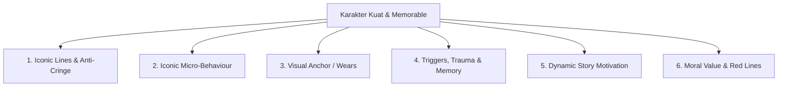
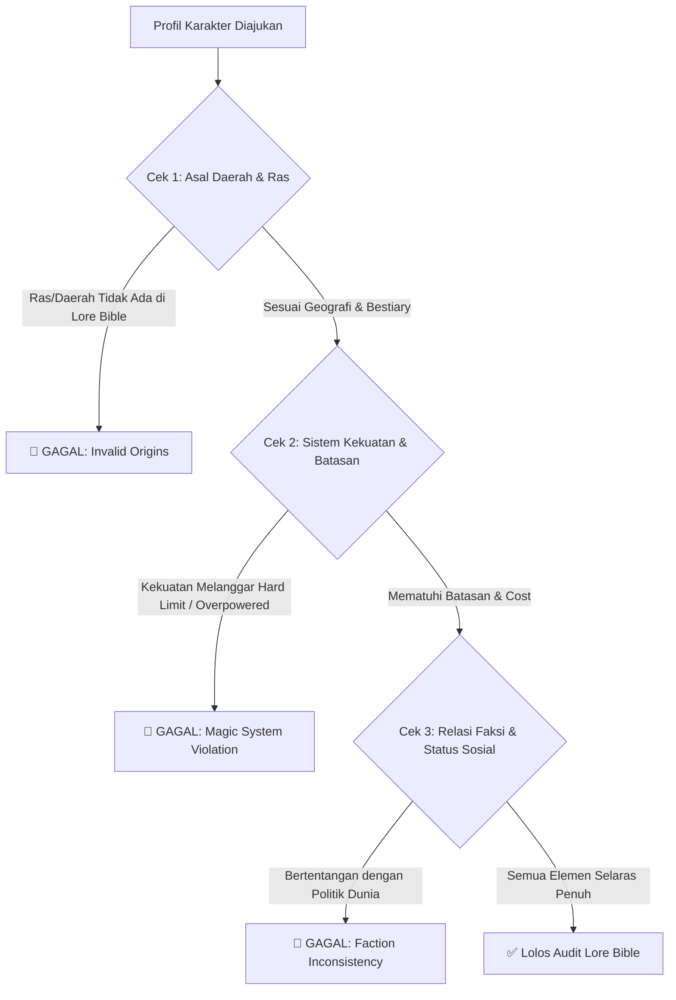

# Panduan Perancangan & Protokol Audit Character Bible

Dokumen ini mendefinisikan standar **Branding Karakter Super-Kuat**, protokol **Wawancara Interaktif (Multi-Pilihan)**, dan mekanisme **Audit Keselarasan Lore Bible**.

---

## 1. Protokol Interaktif Agent: Wawancara Berpilihan (Guided Options)

Saat mendampingi user membuat atau memperdalam Character Bible, agent **WAJIB memandu secara interaktif dengan memberikan opsi konkret** untuk mempermudah pengambilan keputusan.

### Contoh Format Pertanyaan Interaktif Agent ke User:

```text
[TAHAP PEMBENTUKAN KARAKTER: ICONIC HABIT & TRAUMA]
Karakter: [Nama Karakter]
Mari kita tentukan kebiasaan bawah sadar dan pemicu traumanya. Berikut beberapa opsi yang selaras dengan dunianya:

Opsi A (Tipe Pragmatis & Waspada):
- Gestur Khas: Selalu memeriksa tepi belatinya saat terdiam / berdiri dekat pintu keluar.
- Pemicu Trauma: Suara besi beradu keras memicu serangan panik singkat akibat masa lalu sebagai tawanan.

Opsi B (Tipe Tertutup & Menahan Emosi):
- Gestur Khas: Mengusap liontin patah di balik jubahnya saat ragu mengambil keputusan.
- Pemicu Trauma: Bau asap tebal memicu kilas balik kebakaran desanya.

Opsi C (Kustom Sesuai Pilihan Anda):
- Tuliskan ide spesifik Anda sendiri.

-> Manakah opsi yang paling sesuai dengan visi Anda untuk karakter ini?
```

---

## 2. 6 Pilar Branding Karakter Super-Kuat



### 1. Iconic Phrases / Lines (Anti-Cringe & Anti-Repetitif)
- ❌ **Dilarang (Cringe & Maksa):** Mengulang jargon/catchphrase yang sama di setiap paragraf seperti karakter kartun dangkal.
- ✅ **Standar Otentik:** Gaya tutur yang khas (misal: kalimat pendek bernada datar, jeda bicara yang berat, atau analogi spesifik yang hanya digunakan pada momen klimaks emosional).

### 2. Iconic Behaviour (Kebiasaan Gestur Mikro)
- Tindakan refleks tubuh yang memperlihatkan isi pikiran tanpa harus diucapkan lewat kata-kata (*Show, Don't Tell*).

### 3. Iconic Part of Body / Wears (Visual Anchor)
- Satu siluet atau objek visual yang langsung membuat pembaca mengenali karakter tersebut (misal: jubah robek di bahu kiri, mata dengan pupil vertikal, sarung tangan tanpa jari berbahan kulit tebal).

### 4. Responses to Conditions (Trauma & Dynamic Triggers)
- Karakter bukan robot; mereka memiliki titik rapuh yang berakar dari memori masa lalu. Saat terpapar pemicu tertentu, respon fisik/emosionalnya berubah drastis.

### 5. Dynamic Motivation (Tujuan yang Berkembang)
- Tujuan karakter tidak boleh statis dari awal sampai akhir. Kemenangan, kehilangan, dan pengkhianatan harus mampu menggeser prioritas hidup mereka.

### 6. Moral Compass & Red Lines (Batas Moral yang Tak Pernah Dilanggar)
- Karakter harus memiliki prinsip etik yang tegas: hal apa yang rela mereka korbankan, dan hal apa yang pantang mereka lakukan dalam keadaan terdesak sekalipun.

---

## 3. Sistem Audit Keselarasan terhadap Lore Bible (Lore Fit Check)

Setiap profil karakter wajib lolos uji sinkronisasi dengan Lore Bible:



### Checklist Audit Keselarasan Lore:
1. **Pemeriksaan Ras & Fisiologi:** Apakah ras karakter tercatat di Lore Bible? Jika memiliki ciri fisik khusus (sisik, tanduk, mata), apakah sesuai anatomi ras di Lore?
2. **Pemeriksaan Batasan Kekuatan:** Apakah skill/sihir karakter mematuhi aturan *cost/toll* yang ditetapkan di Bab Rules Lore Bible?
3. **Pemeriksaan Latar Belakang Faksi:** Apakah afiliasi politik dan kelas sosial karakter cocok dengan dinamika faksi di Lore Bible?

---

## 4. Checklist Pra-Finalisasi Character Bible

- [ ] User telah dikonfirmasi dan memilih detail karakter melalui opsi interaktif.
- [ ] Profil memiliki 6 pilar branding lengkap dan bebas catchphrase klise/cringe.
- [ ] Reaksi trauma/memori memiliki akar cerita yang logis.
- [ ] Tujuan karakter bersifat dinamis dan memiliki ruang untuk berkembang di alur cerita.
- [ ] Karakter telah lolos uji keselarasan 100% terhadap [LORE_BIBLE_TEMPLATE.md](../lore_bible_creation/LORE_BIBLE_TEMPLATE.md).
