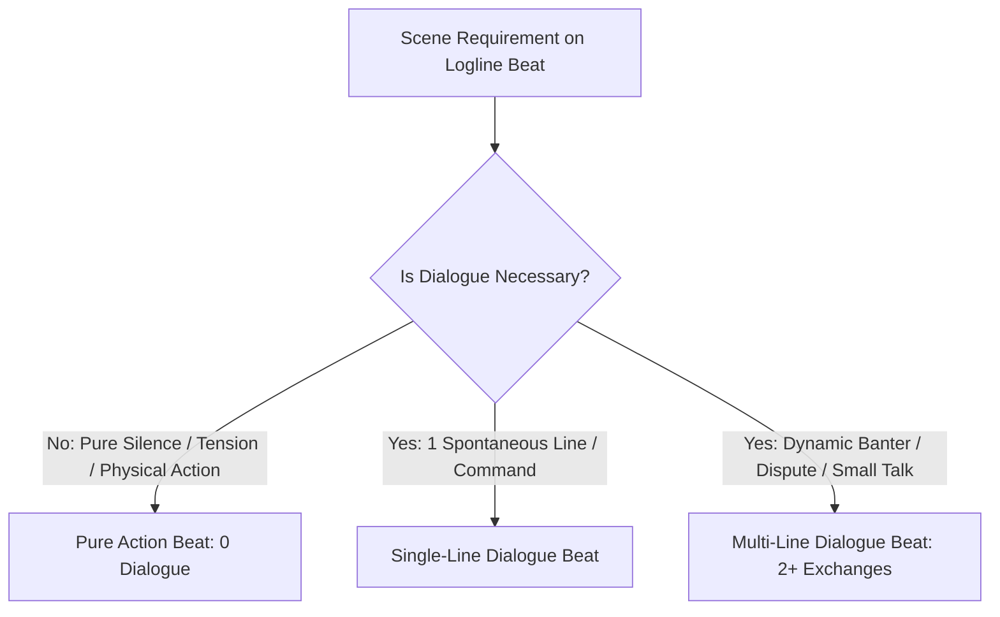

# Dialogue Maker Guide (Fluid Dialogue Integration)

This document defines standards for crafting **Organic & Fluid Dialogue** embedded directly into **Loglines**, adhering to frequency flexibility, meaningful small talk, and the **Character Bible**.

---

## 1. Principle of Fluid Dialogue Dynamics

Dialogue does not follow rigid line counts; it flows naturally based on the needs of the scene:

### 3 Dialogue Frequency Patterns:
1. **Zero-Dialogue Beats (0 Lines):**
   - Highly recommended for tense standoffs, environmental observation, or fast physical action where words would break immersion.
2. **Single-Line Dialogue Beats (1 Line):**
   - A short command, spontaneous outburst, or quiet realization.
3. **Multi-Line Dialogue Beats (2+ Exchanges):**
   - Rapid back-and-forth banter, casual teasing, or disputes within the same beat.

---

## 2. Philosophy: "Small Talk is Necessary"

> [!TIP]
> **Use dialogue only when necessary (*If it's necessary only*), BUT casual small talk is genuinely necessary (*Small talk is necessary*).**

- **Bonding Small Talk:**
  - Arguing over food, complaining about cold mornings, playful teasing, and mundane discussions are **essential for building believable intimacy and chemistry**.
- **Anti-Exposition (*Zero "As you know, Bob"*):**
  - Never use dialogue to artificially lecture the reader about world lore.

---

## 3. Strict Character Bible Alignment

| Aspect in Bible | Implementation in Dialogue |
| :--- | :--- |
| **Voice Register** | Quiet characters speak laconically; warm characters speak comfortably. |
| **Non-Verbal Characters (e.g. Dragons/Rendy)** | Communicate via natural vocalizations (*purrs, snorts, chirps, growls*) and body language. |
| **Speech Tags** | Reflect psychological states (*whispered flatly, snorted softly, stifling a laugh*). |
