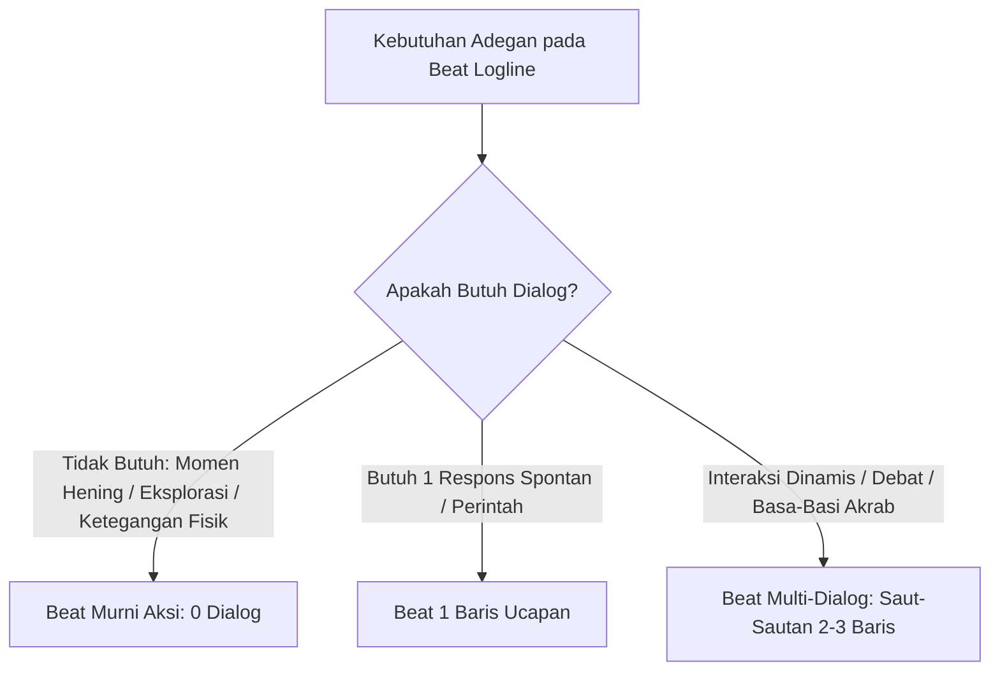

# Panduan & Sistem Dialogue Maker (Integrasi Dialog Fleksibel ke Logline)

Dokumen ini mendefinisikan standar penulisan **Dialog Organik & Luwes** yang disisipkan ke dalam beat **Logline**, dengan prinsip keluwesan frekuensi (*bisa nol, bisa satu, bisa saut-sautan*), pemanfaatan basa-basi alami (*meaningful small talk*), dan kepatuhan mutlak pada **Character Bible**.

---

## 1. Prinsip Keluwesan Dialog (Fluid Dialogue Dynamics)

Dialog tidak memiliki aturan kaku per-beat, melainkan mengalir secara alami sesuai kebutuhan adegan:

### 3 Pola Frekuensi Dialog dalam Beat:
1. **Beat Tanpa Dialog (0 Dialog):**
   - Sangat dianjurkan untuk momen hening, pengamatan lingkungan, suasana tegang, atau aksi fisik cepat di mana kata-kata justru merusak atmosfer.
2. **Beat Dialog Tunggal (1 Baris):**
   - Satu instruksi singkat, celetukan spontan, atau reaksi emosional pendek.
3. **Beat Multi-Dialog (Saut-Sautan 2+ Baris):**
   - Interaksi percakapan dinamis di mana karakter langsung membalas dalam satu rangkaian beat yang sama (misal: saling bantah atau bercanda akrab).

---

## 2. Filosofi "Basa-Basi Itu Perlu" (Meaningful Small Talk)

> [!TIP]
> **Dialog digunakan hanya jika diperlukan (*If it's necessary only*), TETAPI basa-basi santai adalah kebutuhan nyata (*Small talk is necessary*).**

- **Basa-Basi yang Membangun Relasi (*Bonding Small Talk*):**
  - Obrolan santai mengenai makanan, mengeluh dinginnya pagi, saling menggoda/meledek, atau perdebatan sepele adalah **kunci utama membangun keintiman (*chemistry*) karakter** agar terasa seperti makhluk hidup nyata, bukan sekadar bidak penggerak plot.
- **Bukan Ceramah Plot Kaku:**
  - Karakter tidak harus selalu membicarakan misi penyelamatan dunia atau misteri kuno. Obrolan remeh sehari-hari memperkuat ritme *slowburn*.

---

## 3. Kepatuhan Mutlak pada Character Bible

Setiap tag dialog, intonasi, dan kosakata wajib merujuk langsung ke [Character Bible](../character_bible_creation/CHARACTER_BIBLE_TEMPLATE.md):

| Aspek Karakter di Bible | Penerapan pada Dialog & Tag |
| :--- | :--- |
| **Gaya Tutur (Voice Register)** | Karakter pendiam menggunakan kalimat pendek; karakter ramah menggunakan bahasa santai luwes. |
| **Karakter Non-Verbal (e.g. Naga/Rendy)** | Tidak dipaksa bicara bahasa manusia; menggunakan ekspresi vokal alami (*dengkuran, dengusan, geraman*) dan bahasa tubuh. |
| **Tag Dialog & Nada Bicara** | Tag mencerminkan kondisi psikologis karakter (misal: *berbisik ketus, mendengus pelan, menahan tawa*). |
| **Pemicu Emosi / Trauma** | Ketika terpapar pemicu, nada bicara berubah drastis sesuai reaksi di Character Bible (tergagap, membisu, atau meninggi). |

---

## 4. Checklist Kualitas Dialog Luwes

Sebelum rangkaian dialog disahkan:
- [ ] Dialog tidak dipaksakan ada di setiap beat (tersedia beat murni aksi/keheningan).
- [ ] Tersedia beat multi-dialog saut-sautan saat terjadi interaksi akrab atau perdebatan.
- [ ] Terdapat porsi basa-basi alami (*small talk*) untuk menghidupkan hubungan antar karakter.
- [ ] Gaya bicara dan tag dialog selaras 100% dengan profil di Character Bible.
- [ ] Bebas dari eksposisi ceramah kaku dan melodrama yang berlebihan.
