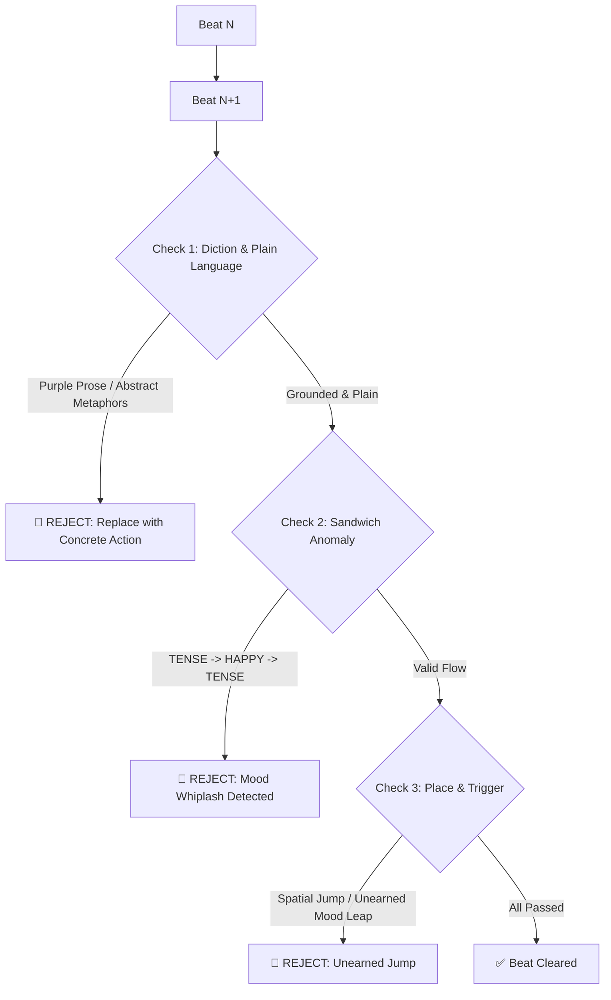

# Standard Logline System (Slowburn Micro-Outlines)

This document defines the format standards for **Micro-Loglines**, the **8 Standardized Mood Variables**, **Anti-AI Slop Rules**, and **Mood Anomaly Audits** to maintain an organic slowburn rhythm.

---

## 1. Definition & Philosophy of Loglines

**Loglines** in this framework are:
- **Sequential Beat-by-Beat Micro-Outlines** where each beat represents a single concrete physical action, micro-gesture, or environmental interaction.
- **Flexible & User-Controlled:** Executed **chapter by chapter** on demand. The user freely dictates granularity (e.g. 30 fast beats, 60 standard beats, or 100+ slowburn beats).
- **1 Concrete Sentence per Beat:** Every beat is formulated as a single, unambiguous action sentence free from abstract summaries.
- Governed by **8 Standardized Mood Tokens** and **Plain Diction** to eliminate wooden, purple AI slop.

---

## 2. Plain Diction & Anti-AI Slop Rules

### A. Anti-AI Slop & Zero Purple Prose
- **Prohibited Abstract / Purple Clichés:**
  - ❌ *Banned:* "weaving a tapestry of silence", "piercing the depths of the soul", "symphony of morning winds", "time creeping like a shadow".
  - ✅ *Use Physical Reality:* "the bedroom was completely silent", "Raya let out a long sigh", "Rendy snorted softly".
- **Concrete, Plain & Unambiguous Verbs:**
  Every sentence must clearly indicate **who** moved, **what** was touched or seen, and **how** their body reacted.

### B. User Register Mirroring
- **Match the desired register:**
  - *Formal/Clean:* Proper sentence structure without archaic or pretentious vocabulary.
  - *Natural/Colloquial:* Natural conversational phrasing (*cuddly, pouty, stroked, sulking*) without forcing unnatural phrasing.

---

## 3. The 8 Standardized Mood Tokens

| Category | Mood Token | Definition & Nuance | Example Scenario |
| :--- | :---: | :--- | :--- |
| **1. Neutral / Calm** | `CALM` | Stable, slow-paced, tranquil, zero pressure. | Typical morning, drinking tea, reading a tome. |
| **2. Warmth / Intimacy** | `WARMTH` | Affectionate, cuddly, familial, protective. | Rendy hugging Raya, tender bonding moment. |
| **3. Unease / Suspicion** | `UNEASE` | Ominous premonition, suspicion, hidden danger. | Strange rustling in brush, suspicious glance. |
| **4. Tension / Conflict** | `TENSE` | High stakes, impending danger, heated dispute. | Pursued by guards, drawn blades, intense argument. |
| **5. Panic / Shock** | `PANIC` | Extreme shock, sudden crisis, life-or-death. | Ambush attack, explosion, dragon severely wounded. |
| **6. Relief / De-escalation**| `RELIEF` | Danger passes, deep breath of relief, safe. | Guard patrol walks past, wound successfully bandaged. |
| **7. Melancholy / Grief** | `MELANCHOLY` | Loss, sorrow, quiet introspection, loneliness. | Remembering fallen kin, bittersweet farewell. |
| **8. Triumph / Joy** | `TRIUMPH` | Satisfaction, milestone reached, celebration. | Mission accomplished, shared victory. |

---

## 4. Standard Beat Syntax

```text
mood : [MOOD_TOKEN], place : [SPECIFIC_LOCATION]
[Number]. [Concrete physical action / gesture / environmental interaction sentence]
```

### Example Beat Sequence (Natural & Clear):
```text
mood : CALM, place : Raya's Bedroom / Bed
1. Morning sunlight filtered through the window blinds, illuminating the thick blanket where Raya and Rendy were asleep.

mood : WARMTH, place : Raya's Bedroom / Bed
2. Rendy clung tightly to Raya's chest with his forelegs, his snout scrunched up in a pout, refusing to get up.

mood : WARMTH, place : Raya's Bedroom / Bed
3. Raya gently scratched the smooth scales behind Rendy's horns to coax him into loosening his grip.

mood : UNEASE, place : Raya's Bedroom / Near the Window
4. Rendy's ears suddenly perked up toward the front gate as heavy armored footsteps echoed from outside.
```

---

## 5. Mood Anomaly & Continuity Audits



### Prohibited Anomaly Patterns:
1. **The Sandwich Anomaly (Prohibited):** `[TENSE] -> [TENSE] -> [TRIUMPH] -> [TENSE]` without a logical cause is flagged as an invalid glitch.
2. **The Unearned Leap (Prohibited):** Jumping from `CALM` directly to `PANIC` without an explicit trigger event recorded in the beat.

---

## 6. Valid Mood Transition Matrix

```text
CALM        ──► WARMTH / UNEASE / MELANCHOLY
WARMTH      ──► CALM / UNEASE / TRIUMPH
UNEASE      ──► TENSE / CALM
TENSE       ──► PANIC / RELIEF / UNEASE
PANIC       ──► RELIEF / MELANCHOLY / TENSE
RELIEF      ──► CALM / WARMTH / TRIUMPH
MELANCHOLY  ──► CALM / RELIEF / UNEASE
TRIUMPH     ──► WARMTH / CALM / UNEASE
```

---

## 7. Beat Validation Checklist

- [ ] **Zero AI Slop:** No abstract purple metaphors; clear, accessible verbs.
- [ ] **Unambiguous Physical Action:** Subject, object, and physical action are unmistakable.
- [ ] **Zero Mood Anomalies:** Flow adheres to the transition matrix without sandwich spikes.
- [ ] **Spatial Continuity:** Every room or location change is anchored by a movement action.
- [ ] **Bible Alignment:** Complies with [CHARACTER_AND_LORE_AUDIT.md](./CHARACTER_AND_LORE_AUDIT.md).
