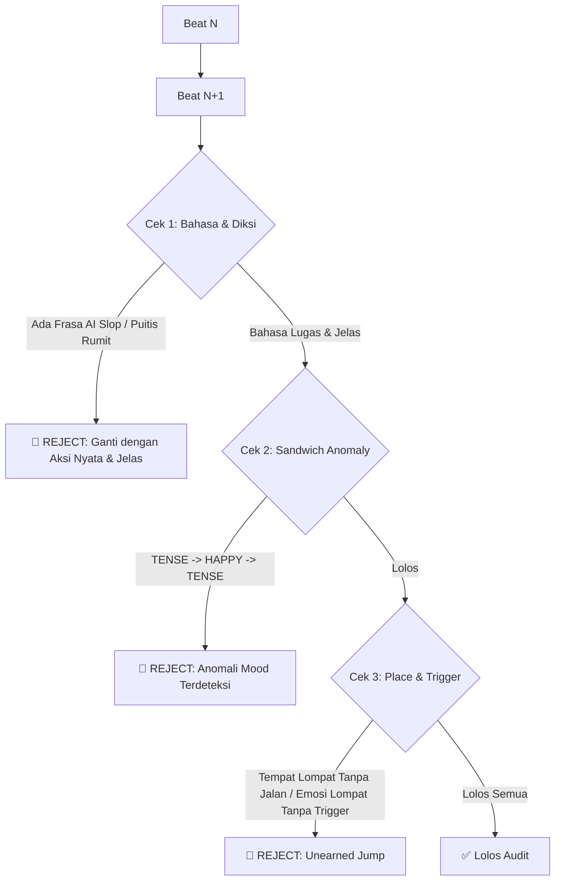

# Standar & Sistem Logline (Slowburn Micro-Outline)

Dokumen ini mendefinisikan standar format **Logline**, sistem **Kategori Variabel Mood**, aturan **Gaya Bahasa & Anti-AI Slop**, serta mekanisme **Audit Anomali Emosi** untuk menjaga cerita tetap runtut, hidup, dan jernih.

---

## 1. Definisi & Filosofi Logline

**Logline** adalah:
- **Mikro-outline berurutan (sequential beat-by-beat)** per kalimat yang mendeskripsikan gestur, aksi fisik, dan interaksi lingkungan secara runtut.
- **Fleksibel & Terkontrol oleh User:** Dieksekusi **bab per bab** sesuai pilihan user (misal: hanya Bab 1 terlebih dahulu). User bebas menentukan tingkat kedalaman/skala beat yang diinginkan (contoh: 30 beat ringkas, 50 beat sedang, hingga 100+ beat slowburn).
- **Format 1 Kalimat Konkret per Beat:** Setiap beat dirumuskan dalam satu kalimat aksi/peristiwa nyata yang jelas, terbebas dari ringkasan abstrak.
- Menggunakan **Variabel Mood Baku** dan **Diksi Lugas (Anti-AI Slop)** agar alur tidak kaku, tidak berbunga-bunga, dan mudah dipahami.


---

## 2. Standar Diksi & Gaya Bahasa (Anti-AI Slop Rules)

Bagian ini mengatur pemilihan kata dan gaya penulisan agar deskripsi beat selalu jernih, alami, dan tidak terdengar seperti "terjemahan mesin kaku".

### A. Anti-AI Slop & Anti-Purple Prose
- **Dilarang menggunakan kata/frasa puitis yang klise atau sok berat:**
  - ❌ *Hindari:* "merajut keheningan yang mencekam", "menembus relung kalbu", "simfoni angin pagi", "denting waktu yang merayap", "tapestry of emotions".
  - ✅ *Gunakan aksi/kondisi fisik nyata:* "suasana kamar hening tanpa suara", "Raya menghela napas panjang", "Rendy mendengus pelan".
- **Gunakan kata yang konkret, jelas, dan tidak ambigu:**
  Setiap kalimat harus langsung menunjukkan **siapa** yang bergerak, **apa** yang disentuh/dilihat, dan **bagaimana** reaksinya secara fisik.

### B. Penyesuaian Gaya Bahasa (User Register Mirroring)
- **Ikuti gaya bahasa yang diinginkan user:**
  - Jika user meminta gaya **baku/formal**: Gunakan tata kalimat rapi dan kosakata formal yang tetap lugas (bukan sastra kuno yang rumit).
  - Jika user menggunakan/meminta gaya **natural/santai/campuran**: Gunakan bahasa sehari-hari yang mengalir wajar (*cuddly*, *pouty*, *ngelus*, *merajuk*, *ngambek*) tanpa memaksakan istilah asing yang kaku.
- **Prinsip Utama:** *Sederhana, to-the-point, detail pada aksi, dan mudah dibayangkan.*

---

## 3. Taksonomi Variabel Mood (Standardized Mood Tokens)

Gunakan 8 kategori variabel terstandar berikut untuk menjaga konsistensi:

| Kategori Mood | Token Variabel | Definisi & Nuansa | Contoh Situasi |
| :--- | :---: | :--- | :--- |
| **1. Netral / Santai** | `CALM` | Suasana stabil, damai, ritme lambat, tidak ada tekanan. | Pagi hari biasa, menikmati teh, membaca buku. |
| **2. Kehangatan / Kedekatan** | `WARMTH` | Penuh kasih sayang, manja, intim, akrab, protektif. | Rendy memeluk Raya, momen manis bersama. |
| **3. Waspada / Tanda Tanya** | `UNEASE` | Ada firasat ganjil, curiga, tanda-tanda bahaya tersembunyi. | Suara gemersik aneh di semak, tatapan mencurigakan. |
| **4. Ketegangan / Konflik** | `TENSE` | Tekanan tinggi, adu argumen, ancaman nyata, bahaya mendekat. | Dikejar musuh, adu pedang, perdebatan sengit. |
| **5. Kepanikan / Syok** | `PANIC` | Kejutan ekstrem, kekacauan instan, hidup-mati. | Serangan mendadak, ledakan, terluka parah. |
| **6. De-eskalasi / Pelegaan** | `RELIEF` | Ketegangan mereda, hembusan napas lega, situasi aman. | Bahaya lewat, luka selesai diobati. |
| **7. Kesedihan / Melankolis** | `MELANCHOLY` | Duka, kehilangan, kesepian, refleksi batin mendalam. | Mengingat masa lalu tragis, perpisahan. |
| **8. Kemenangan / Sukacita** | `TRIUMPH` | Kepuasan, pencapaian target, kebahagiaan bersama. | Berhasil menyelesaikan misi, selebrasi. |

---

## 4. Format Penulisan Logline Baku

```text
mood : [TOKEN_VARIABEL], place : [Lokasi Spesifik]
[Nomor]. [Kalimat aksi fisik / gestur / interaksi konkret yang jelas dan bebas slop]
```

### Contoh Penerapan (Bahasa Natural & Jelas):
```text
mood : CALM, place : Kamar tidur Raya / Atas ranjang
1. Sinar matahari pagi mulai masuk dari celah jendela, menerangi kasur tempat Raya dan Rendy tidur.

mood : WARMTH, place : Kamar tidur Raya / Atas ranjang
2. Rendy masih memeluk Raya erat-erat dengan kaki depannya, wajahnya cemberut manja menolak bangun.

mood : WARMTH, place : Kamar tidur Raya / Atas ranjang
3. Raya mengelus punggung sisik Rendy perlahan, mencoba membujuk agar cengkeramannya melonggar.

mood : UNEASE, place : Kamar tidur Raya / Dekat jendela
4. Telinga Rendy tiba-tiba bergerak tegak ke arah pintu luar setelah mendengar suara derap langkah berat mendekat.
```

---

## 5. Sistem Audit Anomali Mood & Kontinuitas

Audit ini memeriksa alur logline dari awal sampai akhir sebelum disetujui:



### Aturan Anomali:
1. **The Sandwich Anomaly (Dilarang):** Pola `[TENSE] -> [TENSE] -> [TRIUMPH] -> [TENSE]` tanpa alasan logis langsung ditolak.
2. **The Unearned Leap (Dilarang):** Lompatan dari situasi santai (`CALM`) ke darurat hidup-mati (`PANIC`) tanpa kalimat pemicu yang konkret di dalam beat.
3. **The Purple Prose Glitch (Dilarang):** Penggunaan metafora abstrak yang tidak memiliki wujud fisik (contoh: "jiwanya terkoyak oleh sunyi").

---

## 6. Matriks Transisi Mood yang Sah

```text
CALM        ──► WARMTH / UNEASE / MELANCHOLY
WARMTH      ──► CALM / UNEASE / TRIUMPH
UNEASE      ──► TENSE / CALM
TENSE       ──► PANIC / RELIEF / UNEASE
PANIC       ──► RELIEF / MELANCHOLY / TENSE
RELIEF      ──► CALM / WARMTH / TRIUMPH
MELANCHOLY  ──► CALM / RELIEF / UNEASE
TRIUMPH     ──► WARMTH / CALM / UNEASE
```

---

## 7. Checklist Validasi Beat Logline

Setiap pembuatan batch logline wajib memenuhi checklist ini:
- [ ] **Bebas AI Slop:** Tidak ada metafora puitis yang berlebihan/klise; kata-kata mudah dipahami.
- [ ] **Diksi Jelas & Konkret:** Subjek, objek, dan aksinya tidak multitafsir.
- [ ] **Adaptif:** Nada bahasa mengikuti gaya user (baku rapi atau santai wajar).
- [ ] **Bebas Anomali Mood:** Alur emosi mengalir sesuai matriks transisi tanpa lonjakan sandwich.
- [ ] **Kontinuitas Tempat:** Setiap perpindahan ruangan/tempat tercatat melalui aksi fisik.
- [ ] **Integrasi Bible:** Selaras dengan aturan karakter & lore pada [CHARACTER_AND_LORE_AUDIT.md](./CHARACTER_AND_LORE_AUDIT.md).

---

## 8. Dokumen Terkait & Audit Tambahan

- **Audit Karakter & Lore:** Baca panduan lengkap konsistensi bible dan aturan penambahan karakter bernama di [CHARACTER_AND_LORE_AUDIT.md](./CHARACTER_AND_LORE_AUDIT.md).
- **Panduan Evaluasi Skill:** Lihat [SKILL_EVALUATION_GUIDE.md](./SKILL_EVALUATION_GUIDE.md).

