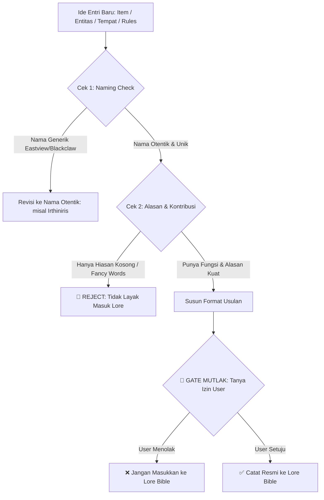

# Panduan & Protokol Kurasi Lore Bible (World Rules & Specifications)

Dokumen ini mendefinisikan aturan penyusunan **Lore Bible**, standar **Penamaan Otentik (Anti-Generic Names)**, batasan **Alasan Kuat & Kontribusi Nyata**, serta **Protokol Wajib Konfirmasi User**.

---

## 1. Definisi & Ruang Lingkup Lore Bible

**Lore Bible** adalah basis data spesifikasi resmi dunia yang memuat:
1. ⚔️ **Item & Objek:** Artefak, senjata, material langka, peninggalan kuno.
2. 🐉 **Entitas & Makhluk:** Ras, naga, monster teritorial, roh, fauna unik.
3. 📜 **Rules & Hukum Dunia:** Sistem sihir/energi, batasan mutlak, pantangan, hukum kausalitas.
4. 🗺️ **Tempat & Environment:** Geografi, kota, reruntuhan, atmosfer, iklim ekstrem.
5. 👥 **Relasi & Sosial:** Hubungan antar faksi/kelompok, strata sosial, tensi politik.
6. ⏳ **Sejarah & Garis Waktu:** Peristiwa masa lalu yang membentuk kondisi dunia saat ini.

---

## 2. Standar Kualitas Entri Lore (Anti-Bloat & Anti-Fancy Words)

Setiap entri yang diajukan wajib memenuhi 2 syarat fundamental:

### A. Wajib Memiliki Alasan Kuat & Kontribusi Nyata
- **Bukan Sekadar Hiasan:** Dilarang menambahkan item, makhluk, atau tempat hanya agar kelihatan "ramai".
- **Harus Berdampak:** Setiap entri harus memiliki fungsi nyata terhadap ekosistem dunia, plot, atau konflik karakter.

### B. Dilarang Menggunakan Kata-Kata 'Fancy' Kosong (*Anti-Pretentious Vocabulary*)
- Hindari istilah rumit yang hanya terdengar keren tapi tidak memiliki mekanisme fungsional.
- Jelaskan fungsi, batasan, dan cara kerja setiap objek/makhluk secara konkret dan membumi.

---

## 3. Konvensi Penamaan (Anti-Generic Compound Words)

Untuk dunia fantasi / dunia lain (*otherworldly*), hindari penamaan generik hasil gabungan kata bahasa Inggris dasar yang klise dan pasaran.

```text
❌ CONTOH GENERIK (HINDARI UNTUK DUNIA FANTASI):
- "Eastview Horizon"
- "Blackclaw Monster"
- "Shadowblade Dagger"
- "Darkwood Forest"
-> Terlalu klise, generik, dan tidak berkesan (lupa dalam 5 menit).

✅ CONTOH OTENTIK & MEMORABLE (GUNAKAN INI):
- Gunakan nama 1 kata yang distingtif, berakar Latin, atau fonetik unik.
- Contoh: 'Irthiniris', 'Valdris', 'Morvath', 'Saeloria', 'Kaelen'.
- Mudah diingat, memiliki identitas kuat, dan terasa seperti nama dunia asli.
```

---

## 4. ATURAN MUTLAK: Protokol Kurasi User (Wajib Tanya Dulu)

> [!IMPORTANT]
> **TIDAK SEMUA DETAIL DUNIA HARUS MASUK KE LORE BIBLE.**
> Agent **DILARANG KERAS** menambahkan, mengubah, atau memasukkan nama/entri baru ke Lore Bible secara sepihak.



---

## 5. Format Baku Pengajuan Entri Lore ke User

Sebelum mencatat entri baru ke dalam Lore Bible, agent **wajib** mengajukan pertanyaan menggunakan format berikut:

```text
[USULAN KANON LORE BIBLE BARU]
- Kategori           : [Item / Entitas / Objek / Rules / Tempat / Relasi / Sejarah]
- Nama Entri         : [Gunakan nama unik 1 kata / Latin / bukan generic compound words, contoh: 'Irthiniris']
- Alasan & Kontribusi: [Mengapa entri ini penting & apa dampaknya bagi dunia/cerita?]
- Spesifikasi        : [Fungsi, karakteristik konkret, bebas kata-kata fancy kosong]
- Batasan / Cost     : [Kelemahan atau biaya penggunaannya]

-> Apakah Anda menyetujui entri ini untuk dicatat secara resmi ke dalam Lore Bible?
```

---

## 6. Checklist Audit Pre-Approval Lore

Sebelum entri Lore Bible disetujui:
- [ ] User telah memberikan izin tertulis.
- [ ] Nama entri otentik/unik (bukan nama generik gabungan kata seperti *Eastview / Blackclaw*).
- [ ] Memiliki alasan keberadaan yang kuat dan kontribusi nyata terhadap dunia/plot.
- [ ] Bebas dari frasa puitis / kata-kata *fancy* yang tidak jelas fungsinya.
- [ ] Memiliki batasan (*limits*) dan biaya (*costs*) yang jelas.
- [ ] Tidak bertentangan dengan entri lain yang sudah ada di Lore Bible.
