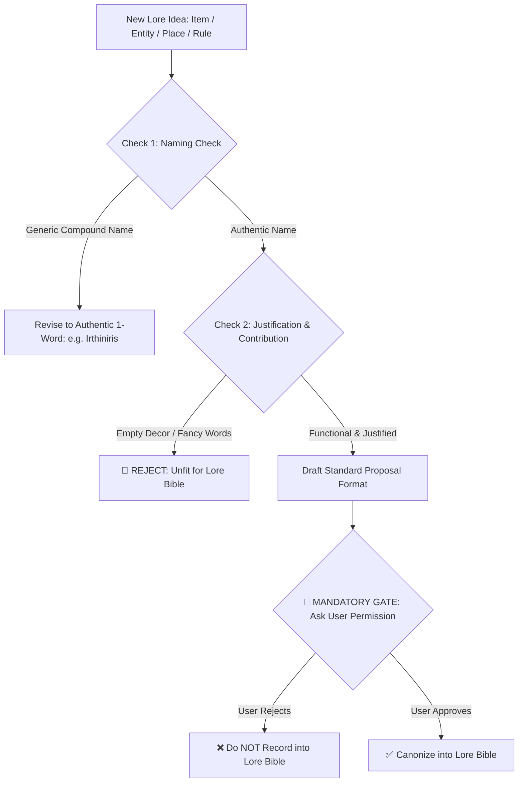

# Lore Bible Curation & Audit Protocol (World Specifications)

This document defines the rules for structuring the **Lore Bible**, enforcing **Authentic Naming Conventions (Anti-Generic Compound Words)**, requiring **Strong Justifications & Tangible Contributions**, and maintaining the **Mandatory User Curation Gate**.

---

## 1. Scope & Taxonomy of the Lore Bible

The **Lore Bible** serves as the official canon repository detailing:
1. ⚔️ **Items & Objects:** Relics, weapons, rare materials, potions, ancient artifacts.
2. 🐉 **Entities & Creatures:** Species, dragons, territorial monsters, spirits, unique fauna.
3. 📜 **Rules & Universal Laws:** Magic/energy mechanics, hard limits, universal taboos, causality laws.
4. 🗺️ **Places & Environments:** Geography, cities, ruins, atmospheres, extreme climates.
5. 👥 **Social Relations & Factions:** Inter-group ties, social hierarchies, political tensions.
6. ⏳ **History & Key Timeline:** Crucial past events shaping current world conditions.

---

## 2. Quality Standards for Lore Entries (Anti-Bloat & Anti-Fancy Words)

Every candidate lore entry must satisfy two fundamental criteria:

### A. Strong Justification & Meaningful Contribution
- **Not Merely Decorative:** Do not invent items, monsters, or locations solely to make the world look crowded.
- **Narrative & Systemic Impact:** Every entry must serve a functional purpose in the ecosystem, plot stakes, or character conflicts.

### B. Anti-Pretentious Vocabulary & Zero Fancy Filler Words
- Avoid convoluted, pseudointellectual jargon that lacks functional mechanics.
- Explain functions, limitations, and operational mechanics clearly and concretely.

---

## 3. Authentic Naming Conventions (Anti-Generic Compound Words)

For fantasy and otherworldly settings, strictly avoid generic, cliché compound English words.

```text
❌ GENERIC EXAMPLES (BANNED FOR FANTASY WORLDS):
- "Eastview Horizon"
- "Blackclaw Monster"
- "Shadowblade Dagger"
- "Darkwood Forest"
-> Cliché, unmemorable, and immersion-breaking.

✅ AUTHENTIC & MEMORABLE EXAMPLES (USE THIS):
- Use distinctive single-word names, Latin-root inspired, or unique phonetics.
- Examples: 'Irthiniris', 'Valdris', 'Morvath', 'Saeloria', 'Kaelen'.
- Memorable, distinct identity, and sounds like an authentic living world.
```

---

## 4. MANDATORY RULE: The User Curation Gate (Ask User First)

> [!IMPORTANT]
> **NOT ALL WORLD DETAILS BELONG IN THE LORE BIBLE.**
> The agent is **STRICTLY PROHIBITED** from unilaterally adding or editing lore entries without explicit user confirmation.



---

## 5. Standard Confirmation Proposal Format

Before adding any entry to the Lore Bible, the agent **MUST** prompt the user using this template:

```text
[PROPOSED LORE BIBLE CANON ENTRY]
- Category      : [Item / Entity / Object / Rule / Place / Relation / History]
- Entry Name    : [Distinctive 1-word / Latin-root name, e.g., 'Irthiniris']
- Justification : [Why is this necessary & how does it impact the story/world?]
- Specification : [Concrete functions, physical characteristics, free of fancy slop]
- Hard Limit    : [Limitations, costs, or side effects]

-> Do you approve adding this entry as official canon in the Lore Bible, or should it remain a passing background detail?
```

---

## 6. Pre-Approval Audit Checklist

- [ ] User gave explicit written confirmation.
- [ ] Entry uses authentic naming (no generic compound words like *Eastview / Blackclaw*).
- [ ] Possesses strong existence justification and narrative contribution.
- [ ] Free from pretentious purple prose or empty fancy words.
- [ ] Features concrete limits and usage costs.
- [ ] Zero contradictions with established lore.
