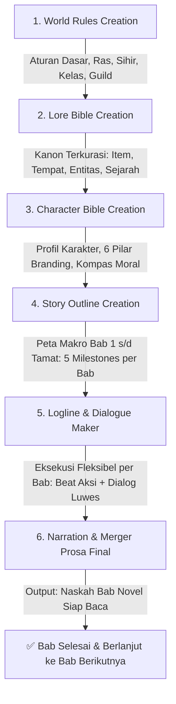

# Master Workflow Pipeline (Panduan Eksekusi Lengkap Penulisan Novel)

Dokumen ini adalah panduan navigasi utama (*Master Blueprint*) yang merangkum seluruh alur kerja end-to-end penulisan novel: mulai dari perancangan aturan semesta, kanon dunia, karakter, outline cerita makro, mikro-logline berdialog, hingga konversi menjadi naskah prosa novel final (yang dapat dieksekusi secara fleksibel **bab per bab**).

---

## 🗺️ Diagram Alur Kerja Utama (6 Tahap Berurutan)

---

## 📂 Matriks Modul & Keterhubungan Antar Folder

| Tahap | Modul / Folder | Fungsi Utama | File Rujukan Kunci |
| :---: | :--- | :--- | :--- |
| **1** | 🏛️ **[world_rules_creation/](./world_rules_creation/)** | Menentukan basis dunia (Real vs Fiksi), sistem sihir/baterai mana, ras & friksi sosial, 3 arketipe kelas, dan ekonomi guild. | [WORLD_RULES_FRAMEWORK.md](./world_rules_creation/WORLD_RULES_FRAMEWORK.md) [WORLD_RULES_TEMPLATE.md](./world_rules_creation/WORLD_RULES_TEMPLATE.md) |
| **2** | 📜 **[lore_bible_creation/](./lore_bible_creation/)** | Repositori kanon spesifikasi dunia (*Item, Entitas, Tempat, Rules, Sejarah*) dengan penamaan otentik (1 kata / Latin-root) dan wajib kurasi user. | [LORE_BIBLE_GUIDE_AND_AUDIT.md](./lore_bible_creation/LORE_BIBLE_GUIDE_AND_AUDIT.md) [LORE_BIBLE_TEMPLATE.md](./lore_bible_creation/LORE_BIBLE_TEMPLATE.md) |
| **3** | 👤 **[character_bible_creation/](./character_bible_creation/)** | Merancang profil tokoh dengan 6 pilar branding (*lines non-cringe, micro-habits, visual anchor, trauma triggers, dynamic motivation, moral compass*) & wawancara multi-pilihan. | [CHARACTER_BIBLE_GUIDE_AND_AUDIT.md](./character_bible_creation/CHARACTER_BIBLE_GUIDE_AND_AUDIT.md) [CHARACTER_BIBLE_TEMPLATE.md](./character_bible_creation/CHARACTER_BIBLE_TEMPLATE.md) |
| **4** | 🗺️ **[story_outline_creation/](./story_outline_creation/)** | Memetakan Grand Roadmap cerita dari Bab 1 hingga Akhir Cerita (4 Babak Narasi & 5 Milestones A-E per bab) sebagai pengarah alur. | [OUTLINE_FRAMEWORK_AND_SYNTHESIS.md](./story_outline_creation/OUTLINE_FRAMEWORK_AND_SYNTHESIS.md) [STORY_OUTLINE_TEMPLATE.md](./story_outline_creation/STORY_OUTLINE_TEMPLATE.md) |
| **5** | 🎬 **[logline_skill_framework/](./logline_skill_framework/)** & **[dialogue_maker/](./dialogue_maker/)** | Eksekusi mikro-beat bab per bab (30–100+ beat) dengan variabel `mood` & `place`, audit anti-anomali suasana, dan penyisipan dialog luwes (termasuk basa-basi & non-verbal). | [LOGLINE_SYSTEM.md](./logline_skill_framework/LOGLINE_SYSTEM.md) [DIALOGUE_BEAT_TEMPLATE.md](./dialogue_maker/DIALOGUE_BEAT_TEMPLATE.md) |
| **6** | ✍️ **[narration_and_merger/](./narration_and_merger/)** | Menggabungkan aksi logline, dialog, dan dialog tag menjadi paragraf prosa novel yang utuh, mengalir, membumi, dan bebas dari kata kerja/frasa tidak umum. | [NARRATION_AND_MERGER_GUIDE.md](./narration_and_merger/NARRATION_AND_MERGER_GUIDE.md) [PROSE_MERGER_TEMPLATE.md](./narration_and_merger/PROSE_MERGER_TEMPLATE.md) |

---

## 🚀 Panduan Eksekusi Tahap demi Tahap (Execution Protocol)

### 🏛️ Tahap 1: Membangun World Rules
1. Agent mengajukan pertanyaan klarifikasi basis realisme (*Full Real-Life*, *Semi-Real*, atau *Full Fictional RPG*).
2. Tentukan hukum alam, kapasitas mana biologis & batu baterai, dinamika 3 kelas (*Vanguard, Spellcaster, Striker*), birokrasi ujian S1, dan ketegangan rasial.
3. Simpan hasil di [WORLD_RULES_TEMPLATE.md](./world_rules_creation/WORLD_RULES_TEMPLATE.md).

### 📜 Tahap 2: Mengisi Lore Bible (Kanon Terkurasi)
1. Agent mengajukan usulan entri lore menggunakan format baku (*User Curation Gate*).
2. Terapkan konvensi penamaan otentik (misal: *'Irthiniris', 'Valdris'*). Hindari nama generik (*Eastview / Blackclaw*).
3. Catat fungsi konkret, batasan mutlak, dan biaya penggunaan (*cost*) di [LORE_BIBLE_TEMPLATE.md](./lore_bible_creation/LORE_BIBLE_TEMPLATE.md).

### 👤 Tahap 3: Membentuk Character Bible
1. Agent memandu user melalui wawancara interaktif berbasis opsi pilihan (*Multi-Choice*).
2. Isi 6 pilar branding kuat (kebiasaan gestur mikro, visual anchor, pemicu trauma, motivasi dinamis, dan batas moral).
3. Jalankan audit keselarasan terhadap Lore Bible dan simpan di [CHARACTER_BIBLE_TEMPLATE.md](./character_bible_creation/CHARACTER_BIBLE_TEMPLATE.md).

### 🗺️ Tahap 4: Menyusun Grand Story Outline
1. Sintesiskan motivasi karakter, lokasi lore, dan rintangan aturan dunia.
2. Petakan alur cerita secara utuh dari Bab 1 sampai Bab Terakhir di [STORY_OUTLINE_TEMPLATE.md](./story_outline_creation/STORY_OUTLINE_TEMPLATE.md).
3. Tentukan target 5 Milestones (A s/d E) untuk masing-masing bab.

### 🎬 Tahap 5: Menyusun Logline & Dialog (Modular per Bab)
1. User memilih bab mana yang ingin dikerjakan (contoh: *"Buat logline Bab 1"*).
2. User menentukan tingkat kedalaman beat (contoh: *"Bikin 60 beat slowburn"*).
3. Agent menyusun beat 1 kalimat aksi konkret dengan token mood baku (`CALM`, `WARMTH`, `UNEASE`, `TENSE`, `PANIC`, `RELIEF`, `MELANCHOLY`, `TRIUMPH`).
4. Sisipkan dialog luwes: beat murni aksi (0 dialog), dialog 1 baris, atau multi-dialog saut-sautan basa-basi alami.
5. Simpan di dokumen logline bab terkait.

### ✍️ Tahap 6: Narration & Merger (Prosa Bab Final - Modular per Bab)
1. Gabungkan aksi logline, dialog, dan dialog tag menjadi rangkaian alinea novel yang dinamis.
2. Terapkan filter bahasa:
   - **Bahasa Lugas & Jelas:** Tanpa *sugar-coating* dan tanpa metafora puitis berlebihan (*zero purple prose*).
   - **Bebas Kata Tidak Umum:** Hindari kata kerja/frasa sastra berat/arkais (*menderai, meruyak, menelikung*); gunakan kata kerja wajar sehari-hari.
3. Naskah bab selesai dan siap dinikmati! Lanjutkan ke bab berikutnya dengan mengulang Tahap 5 & 6.

---

## 🛡️ 5 Aturan Universal Seluruh Sistem (Golden Rules)

1. **User In Control:** Setiap penambahan karakter bernama baru atau entri Lore Bible **WAJIB** meminta izin/konfirmasi user terlebih dahulu.
2. **Anti-AI Slop & Plain Language:** Bahasa wajib jernih, membumi, dan tidak ambigu. Deskripsi berfokus pada aksi fisik nyata.
3. **Anti-Mood Anomaly:** Alur emosi wajib mengalir alami sesuai matriks transisi; dilarang lonjakan *Sandwich Anomaly* (`TENSE -> HAPPY -> TENSE`).
4. **Meaningful Small Talk:** Basa-basi santai antar karakter diakui sebagai kebutuhan nyata untuk membangun keintiman dan *chemistry*.
5. **Modular & Flexible Execution:** Pembuatan logline dan konversi narasi prosa dapat dilakukan bab per bab secara bertahap tanpa harus sekaligus.
