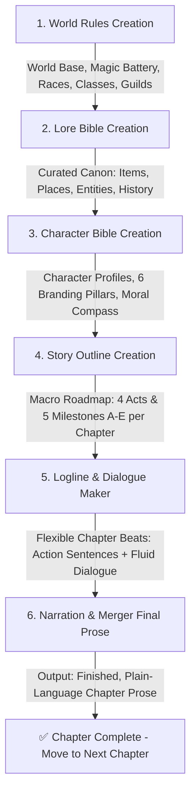

# Master Workflow Pipeline (End-to-End Novel Creation Manual)

This document serves as the **Master Execution Blueprint**, providing a complete end-to-end guide for creating serialized slowburn novels: from foundational world mechanics, curated lore, and character branding, to grand outlines, mood-tracked micro-loglines, and chapter-by-chapter final prose conversion.

---

## 🗺️ Master Workflow Architecture (6 Sequential Stages)

---

## 📂 Modular Directories & Cross-Module Connectivity

| Stage | Module / Directory | Primary Purpose | Key Reference Files |
| :---: | :--- | :--- | :--- |
| **1** | 🏛️ **[world_rules_creation/](./world_rules_creation/)** | Defines world realism baselines, internal biological mana, mana-battery storage crystals, social/racial tensions, 3 class archetypes, and guild labor markets. | [WORLD_RULES_FRAMEWORK.md](./world_rules_creation/WORLD_RULES_FRAMEWORK.md) [WORLD_RULES_TEMPLATE.md](./world_rules_creation/WORLD_RULES_TEMPLATE.md) |
| **2** | 📜 **[lore_bible_creation/](./lore_bible_creation/)** | Curated canon repository for *Items, Entities, Places, Rules, Social Dynamics, and History* using authentic naming (*Irthiniris*) and mandatory user curation. | [LORE_BIBLE_GUIDE_AND_AUDIT.md](./lore_bible_creation/LORE_BIBLE_GUIDE_AND_AUDIT.md) [LORE_BIBLE_TEMPLATE.md](./lore_bible_creation/LORE_BIBLE_TEMPLATE.md) |
| **3** | 👤 **[character_bible_creation/](./character_bible_creation/)** | Profiles characters across 6 branding pillars (*Non-cringe lines, Micro-habits, Visual anchors, Trauma triggers, Dynamic motivations, Moral compass*) via guided multi-choice interviews. | [CHARACTER_BIBLE_GUIDE_AND_AUDIT.md](./character_bible_creation/CHARACTER_BIBLE_GUIDE_AND_AUDIT.md) [CHARACTER_BIBLE_TEMPLATE.md](./character_bible_creation/CHARACTER_BIBLE_TEMPLATE.md) |
| **4** | 🗺️ **[story_outline_creation/](./story_outline_creation/)** | Maps the Grand Story Roadmap from Chapter 1 to the Finale (4 Acts & 5 Mandatory Milestones A–E per chapter) as the overarching direction for beats. | [OUTLINE_FRAMEWORK_AND_SYNTHESIS.md](./story_outline_creation/OUTLINE_FRAMEWORK_AND_SYNTHESIS.md) [STORY_OUTLINE_TEMPLATE.md](./story_outline_creation/STORY_OUTLINE_TEMPLATE.md) |
| **5** | 🎬 **[logline_skill_framework/](./logline_skill_framework/)** & **[dialogue_maker/](./dialogue_maker/)** | Executes micro-beats chapter by chapter (30–100+ beats) with `mood` & `place` tags, mood-anomaly audits, and fluid dialogue (including small talk & creature lines). | [LOGLINE_SYSTEM.md](./logline_skill_framework/LOGLINE_SYSTEM.md) [DIALOGUE_BEAT_TEMPLATE.md](./dialogue_maker/DIALOGUE_BEAT_TEMPLATE.md) |
| **6** | ✍️ **[narration_and_merger/](./narration_and_merger/)** | Merges logline actions, spoken dialogue, and speech tags into complete novel paragraphs. Enforces strict anti-slop, plain-language, and zero purple prose rules. | [NARRATION_AND_MERGER_GUIDE.md](./narration_and_merger/NARRATION_AND_MERGER_GUIDE.md) [PROSE_MERGER_TEMPLATE.md](./narration_and_merger/PROSE_MERGER_TEMPLATE.md) |

---

## 🚀 Step-by-Step Execution Protocol

### 🏛️ Stage 1: World Rules Creation
1. The agent asks the user to clarify the world baseline (*Full Real-Life*, *Semi-Real + Fiction*, or *Full Fictional RPG World*).
2. Formulate fundamental mechanics: biological mana, mana-battery storage, 3 official classes (*Vanguard, Spellcaster, Striker*), university-degree equivalent licensing exams, and racial frictions (e.g. Human vs Beastmen).
3. Save official results in [WORLD_RULES_TEMPLATE.md](./world_rules_creation/WORLD_RULES_TEMPLATE.md).

### 📜 Stage 2: Lore Bible Creation (Curated Canon)
1. The agent proposes candidate lore entries using the standard confirmation format (**User Curation Gate**).
2. Enforce authentic single-word / Latin-root naming (*e.g., 'Irthiniris', 'Valdris'*). Ban generic compound names (*Eastview / Blackclaw*).
3. Record tangible functions, hard limits, and usage costs in [LORE_BIBLE_TEMPLATE.md](./lore_bible_creation/LORE_BIBLE_TEMPLATE.md).

### 👤 Stage 3: Character Bible Creation
1. Guide the user through an interactive, multi-choice interview to flesh out character details easily.
2. Formulate the 6 core branding pillars: micro-habits, visual anchors, trauma triggers, dynamic motivations, and moral red lines.
3. Verify 100% lore alignment and store in [CHARACTER_BIBLE_TEMPLATE.md](./character_bible_creation/CHARACTER_BIBLE_TEMPLATE.md).

### 🗺️ Stage 4: Grand Story Outline Creation
1. Synthesize character drives, lore settings, and world rule frictions.
2. Outline the entire journey from Chapter 1 to the Finale across 4 Narrative Acts in [STORY_OUTLINE_TEMPLATE.md](./story_outline_creation/STORY_OUTLINE_TEMPLATE.md).
3. Establish 5 Chapter Milestones (A through E) for each chapter.

### 🎬 Stage 5: Logline & Dialogue Drafting (Chapter-by-Chapter)
1. The user selects the target chapter (e.g., *"Let's draft Chapter 1"*) and specifies granularity (e.g., *"Make 60 slowburn beats"*).
2. The agent generates sequential 1-sentence action beats with standard mood tokens (`CALM`, `WARMTH`, `UNEASE`, `TENSE`, `PANIC`, `RELIEF`, `MELANCHOLY`, `TRIUMPH`).
3. Enforce anti-whiplash audits (block the *Sandwich Anomaly*: `TENSE -> HAPPY -> TENSE`).
4. Integrate fluid dialogue: zero-dialogue beats, single punchy lines, or multi-line natural banter/creature dialogue.

### ✍️ Stage 6: Narration & Merger (Final Prose - Modular per Chapter)
1. Fuse logline actions, spoken lines, and speech tags into dynamic novel paragraphs.
2. Enforce strict diction filters:
   - **Plain & Grounded Language:** Zero purple prose, zero sugar-coating, direct physical grounding.
   - **Zero Archaic / Obscure Verbs:** Strictly avoid pretentious literary words; use natural, everyday Indonesian/English verbs.
3. The chapter is complete and ready to read! Repeat Stages 5 & 6 for subsequent chapters.

---

## 🛡️ The 5 Universal Golden Rules

1. **User in Control:** The agent MUST obtain user confirmation before canonizing any lore entry or introducing new named characters.
2. **Anti-AI Slop & Plain Language:** Prose must be clear, grounded, and unambiguous. Descriptions must focus on physical reality.
3. **Anti-Mood Anomaly:** Emotional flow must follow the valid state transition matrix; random mood spikes are strictly prohibited.
4. **Meaningful Small Talk:** Everyday casual banter is an essential requirement for building authentic character chemistry.
5. **Modular & Flexible Execution:** Loglines and prose conversion are executed chapter by chapter on demand.
