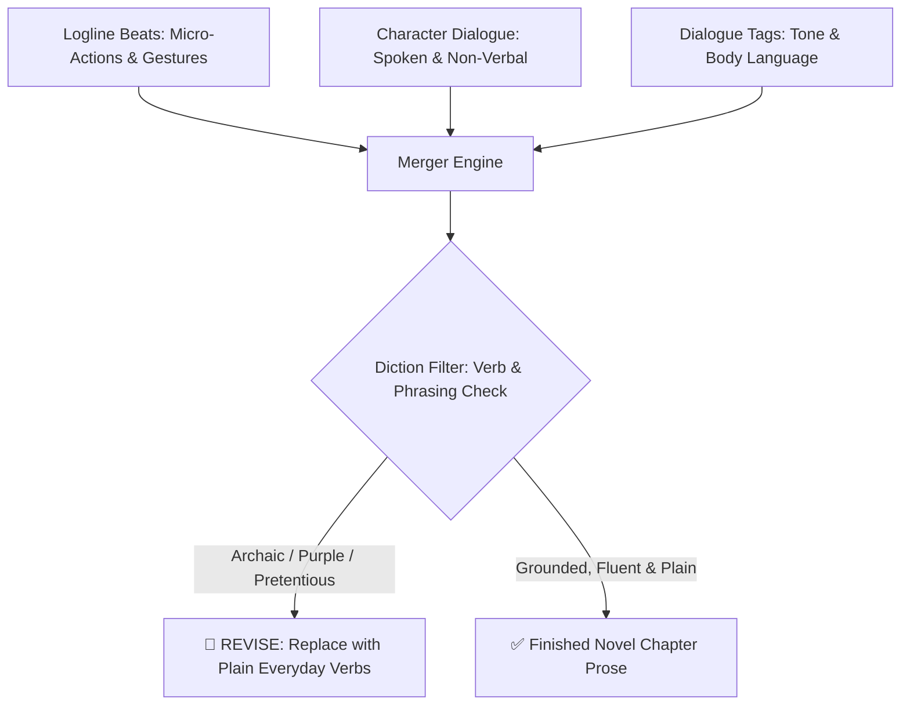

# Narration & Merger Guide (Logline to Final Novel Prose)

This document defines the rules for fusing **Logline Actions**, **Character Dialogues**, and **Speech Tags** into **Final Novel Prose Paragraphs** that flow naturally, remain easy to read, and strictly avoid obscure/archaic vocabulary.

---

## 1. Narrative Style: Plain, Grounded & Anti-Sugar Coating



### 3 Core Narrative Principles:
1. **Plain, Understandable Language:**
   - Use straightforward sentences describing physical reality. Readers should never need a dictionary to understand character actions.
2. **Zero Purple Prose & No Sugar-Coating:**
   - ❌ *Banned:* "silence wove through the corridors of the night", "her steps echoed the weeping of the stars".
   - ✅ *Grounded Reality:* "the room was completely silent", "she walked slowly, favoring her injured leg".
3. **Ban on Obscure & Archaic Verbs:**
   - ❌ *Avoid heavy, archaic literary verbs.*
   - ✅ *Use natural everyday verbs:* *opened, glanced, stroked, snorted, held, stepped, pulled, turned, held her breath*.

---

## 2. The Fluid Merger Technique

Avoid mechanical, formulaic paragraphing (*Action -> Line -> Action -> Line*). Blend elements dynamically:

### Dynamic Merger Formula:

```text
[Environmental Detail / Lead-in Gesture] + [Character Action] + "[Dialogue Line]," [Subtle Delivery Tag], "[Second Line if applicable]." + [Companion's Physical Reaction].
```

---

## 3. Real Transformation: Logline Beats to Finished Prose

### Input: Dialogue-Infused Logline Beats (Chapter 1 Sample)
```text
mood : CALM, place : Raya's Bedroom / Bed
1. The morning air was cool, thin frost clinging to the windowpane as Raya slowly opened her eyes.
2. Rendy the small dragon rested his snout on Raya's chest, eyes clamped shut, refusing to leave the warm bed.
3. Raya stroked the scales behind Rendy's horns and whispered -> Raya: "Rendy... you're heavy, get up." (her voice raspy with sleep).
4. Rendy scrunched up his snout and flicked his tail -> Rendy: *[Sleepy disgruntled purr]* (pulling the blanket over his head).
```

### Output: Finished Novel Prose Paragraphs (Fluid & Plain)
> The morning air was still crisp and cool, with a thin layer of frost clinging to the bedroom windowpane as Raya slowly opened her eyes. Resting right on her chest, Rendy had his small snout pressed flat against the blankets, his eyes shut tight, thoroughly refusing to leave the warmth of the bed.
>
> Raya let out a soft sigh and stroked the smooth scales behind her dragon's horns. "Rendy... you're heavy, get up," she whispered, her voice still raspy with sleep.
>
> Instead of moving, Rendy scrunched up his snout and let out a sleepy, disgruntled purr. His tail flicked lazily against the mattress before he deliberately yanked the edge of the thick blanket over his head.

---

## 4. Pre-Finalization Checklist

- [ ] **Zero Archaic Verbs:** No obscure or pretentious literary terms.
- [ ] **Micro-Gestures Preserved:** Logline actions and body language are not cut or summarized away.
- [ ] **Fluid Flow:** Paragraphs read naturally aloud (*read-aloud test*).
- [ ] **Grounded Tone:** Free from melodrama and purple prose.
