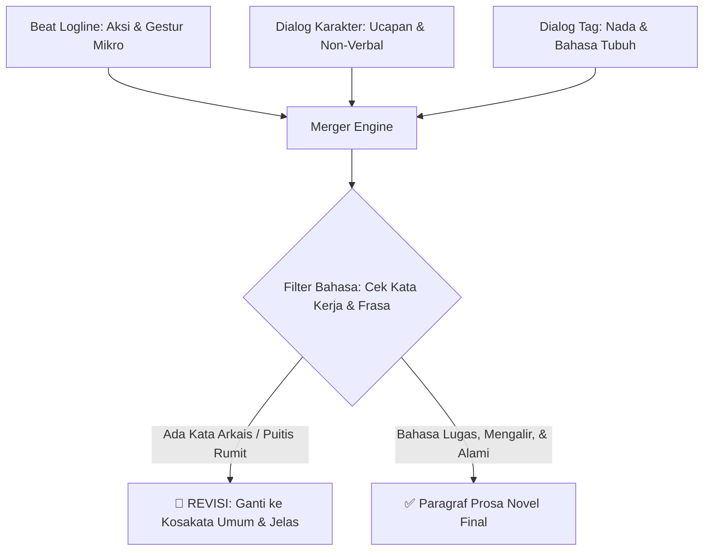

# Panduan & Sistem Narration & Merger (Transformasi Logline ke Prosa Novel)

Dokumen ini mendefinisikan standar penggabungan (*merger*) antara **Aksi Logline**, **Dialog Karakter**, dan **Dialog Tag** menjadi **Paragraf Narasi Prosa Final** yang mengalir luwes, mudah dipahami, jernih, serta bebas dari kata-kata puitis/arkais yang tidak lazim.

---

## 1. Filosofi Gaya Narasi: Jelas, Membumi, & Anti-Sugar Coating



### 3 Prinsip Utama Narasi:
1. **Bahasa yang Mudah Dipahami (Plain & Clear Language):**
   - Gunakan kalimat yang langsung menggambarkan situasi nyata. Pembaca tidak perlu membuka kamus untuk memahami aksi karakter.
2. **Anti-Puitis & Anti-Sugar Coating (Zero Purple Prose):**
   - ❌ **Dilarang:** Metafora abstrak berbunga-bunga (*"keheningan merajut relung malam"*, *"langkahnya berpadu dengan kepedihan semesta"*).
   - ✅ **Gunakan:** Fakta fisik dan tindakan konkret (*"ruangan itu sangat sepi"*, *"ia melangkah pelan menahan sakit di kakinya"*).
3. **Larangan Frasa & Kata Kerja Tidak Umum:**
   - ❌ **Hindari kata kerja/frasa sastra berat/arkais:** *menderai, meruyak, menelikung, melingkupi kalbu, bergeming, nan indah, temaram gulita*.
   - ✅ **Gunakan kata kerja wajar sehari-hari:** *membuka, melirik, mengelus, mendengus, memegang, melangkah, menarik, menoleh*.

---

## 2. Teknik Penggabungan Luwes (*The Fluid Merger*)

Saat menggabungkan rentetan beat logline menjadi paragraf novel, hindari pola mekanis yang kaku (*Aksi -> Dialog -> Aksi -> Dialog*). Gabungkan secara organik:

### Rumus Penggabungan Dinamis:

```text
[Aksi Lingkungan / Gestur Pembuka] + [Aksi Karakter Utama] + "[Dialog Ucapan]," [Dialog Tag Halus], "[Lanjutan Ucapan jika ada]." + [Reaksi Fisik Karakter Lawan].
```

---

## 3. Komparasi Nyata: Dari Beat Logline ke Paragraf Prosa Final

### Input: Rangkaian Beat Logline & Dialog (Contoh Bab 1)
```text
mood : CALM, place : Kamar tidur Raya / Ranjang kayu
1. Udara pagi terasa sejuk, embun tipis masih menempel di kaca jendela saat Raya membuka mata perlahan.

mood : WARMTH, place : Kamar tidur Raya / Ranjang kayu
2. Rendy si naga kecil menindihkan moncongnya ke dada Raya, kelopak matanya terpejam rapat menolak bergerak dari kasur hangat.

mood : WARMTH, place : Kamar tidur Raya / Ranjang kayu
3. Raya mengelus punggung sisik Rendy lalu berbisik -> Raya: "Rendy... berat, ayo bangun." (nadanya serak khas orang baru bangun tidur).

mood : WARMTH, place : Kamar tidur Raya / Ranjang kayu
4. Rendy mengerucutkan bibirnya dan mengibaskan ekor pelan -> Rendy: *[Dengkuran malas bernada merajuk]* (menarik ujung selimut menutupi kepalanya).
```

### Output: Hasil Merger Paragraf Prosa Final (Luwes & Jelas)
> Udara pagi masih terasa sejuk, dan embun tipis menempel di kaca jendela kamar saat Raya perlahan membuka matanya. Di atas dadanya, Rendy menindihkan moncong kecilnya dengan kelopak mata terpejam rapat, menolak beranjak dari kasur yang hangat.
>
> Raya menghela napas pelan sambil mengelus punggung sisik naganya. "Rendy... berat, ayo bangun," bisiknya dengan suara yang masih serak.
>
> Bukannya bangun, Rendy justru mengerucutkan bibirnya dan mendengkur malas dengan nada merajuk. Ekornya mengibas pelan di atas kasur, lalu dengan sengaja menarik ujung selimut tebal itu hingga menutupi seluruh kepalanya.

---

## 4. Checklist Pra-Finalisasi Prosa

Sebelum draf paragraf disahkan:
- [ ] **Bebas Kata Arkais:** Tidak ada kata kerja atau frasa puitis yang tidak umum.
- [ ] **Detail Gestur Tetap Hidup:** Gestur mikro dari logline tidak dipotong atau dirangkum secara terburu-buru.
- [ ] **Aliran Luwes:** Penggabungan dialog, tag, dan aksi terasa alami saat dibaca bersuara (*read-aloud test*).
- [ ] **Sesuai Tone:** Deskripsi membumi, jelas, dan tidak ada kesan melodramatis yang dipaksakan.
