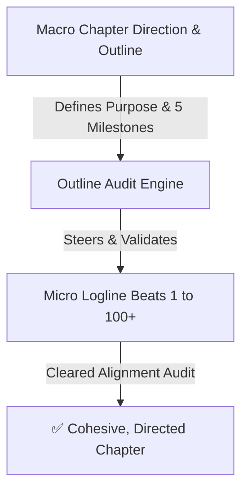
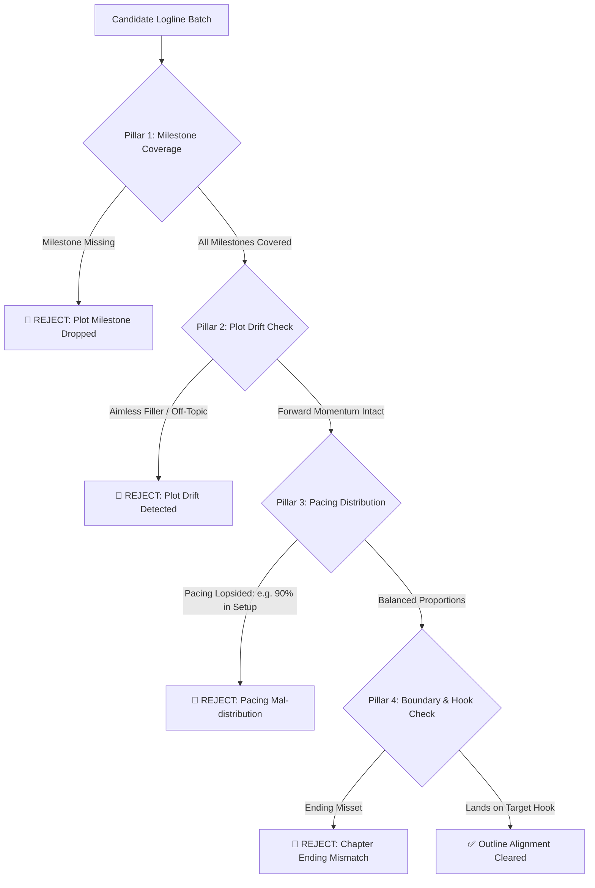

# Outline & Chapter Direction Audit Protocol

This document defines audit protocols to ensure sequential micro-loglines (50–100+ beats) adhere strictly to the **Chapter Outline & Narrative Direction**, preventing plot drift and aimless filler.

---

## 1. Hierarchy: Macro Outline vs. Micro Loglines

- **Macro Direction:** High-level roadmap establishing chapter stakes, mandatory plot milestones, conflicts, and the ending hook.
- **Micro Loglines:** Step-by-step 1-sentence beats executing that roadmap in detail (*slowburn*).

---

## 2. The 4 Outline Alignment Audit Pillars

### 1. Milestone Coverage Audit
- **Goal:** Verifies that all 5 milestones (A through E) from the outline occur sequentially within the loglines.

### 2. Plot Drift & Anti-Aimless Filler Audit
- **Goal:** Distinguishes *purposeful slowburn* from *aimless filler*. Every beat must contribute to emotional stakes, atmosphere, or forward momentum toward the next milestone.

### 3. Pacing Proportion Audit (Ideal 100-Beat Distribution)
- **Milestone A (Opening & Setup):** ~15 - 20 beats.
- **Milestone B (Shift / Catalyst):** ~20 - 25 beats.
- **Milestone C (Midpoint Escalation):** ~25 - 30 beats.
- **Milestone D (Decisive Climax):** ~15 - 20 beats.
- **Milestone E (Ending Hook / Cliffhanger):** ~5 - 10 beats.

### 4. Boundary & Ending Hook Audit
- **Goal:** Ensures the beat sequence concludes precisely at the designated chapter cliffhanger without spilling into subsequent chapter events.
