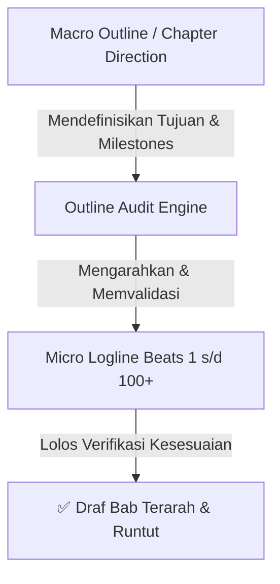
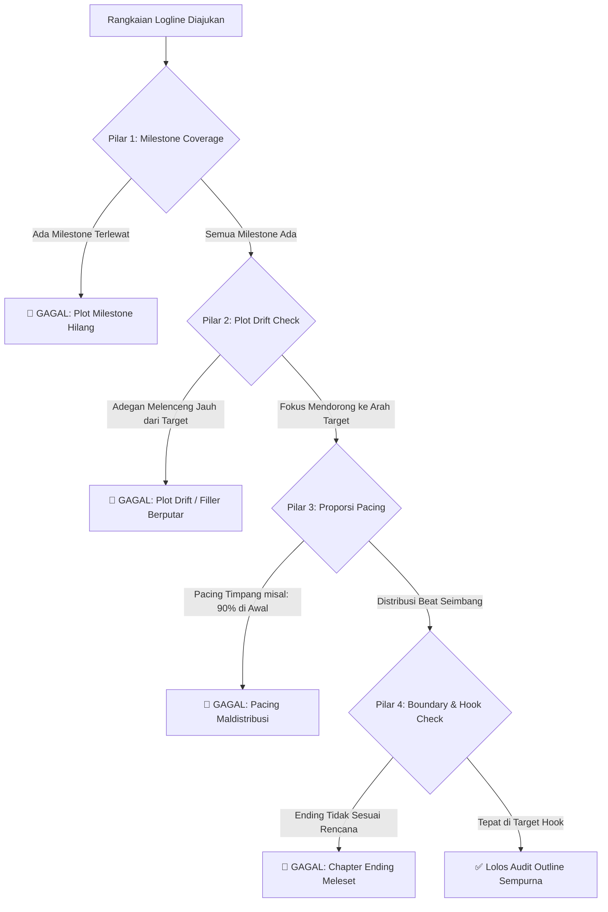

# Standar & Protokol Audit Kesesuaian Outline (Chapter Direction Audit)

Dokumen ini mendefinisikan standar audit untuk memastikan bahwa rangkaian mikro-logline (50–100+ beat) selalu berjalan **sesuai arah dan tujuan (*direction*) dari Outline Bab**, tanpa melenceng (*plot drift*) atau menjadi filler kosong yang berputar-putar.

---

## 1. Hubungan Hierarki: Macro Outline vs Micro Logline



- **Macro Outline / Direction:** Peta jalan tingkat tinggi (High-Level Roadmap) yang menentukan awal bab, peristiwa kunci yang harus terjadi, konflik, dan ending hook bab.
- **Micro Logline:** Rincian langkah demi langkah per kalimat yang menjalankan peta jalan tersebut secara mendalam (*slowburn*).

---

## 2. Format Standar Input Chapter Direction

Sebelum logline dibuat, arah bab (*direction*) didefinisikan menggunakan format standar berikut:

```text
[CHAPTER DIRECTION & OUTLINE]
- Bab: [Nomor & Judul Bab]
- Target Emosional / Inti Bab: [Tujuan utama karakter atau konflik yang harus dihadapi]
- Milestones Wajib (Tonggak Plot):
  1. Milestone A (Opening): [Keadaan awal dan pemicu aktivitas]
  2. Milestone B (Inciting/Shift): [Peristiwa atau temuan baru yang mengubah arah aksi]
  3. Milestone C (Mid-point/Escalation): [Konflik, hambatan, atau interaksi kunci]
  4. Milestone D (Climax/Peak): [Puncak ketegangan atau keputusan penting]
  5. Milestone E (Ending Hook): [Kondisi akhir bab / cliffhanger penutup]
- Alokasi Estimasi Beat: [Misal: 80 - 100 beat]
```

---

## 3. 4 Pilar Audit Kesesuaian Outline (Alignment Checks)

Setiap batch logline diaudit menggunakan 4 parameter utama:



---

### Rincian 4 Pilar Audit:

### 1. Milestone Coverage Audit (Pemeriksaan Tonggak Plot)
- **Tujuan:** Memastikan setiap milestone penting yang ada di outline benar-benar terjadi di dalam logline.
- **Deteksi Pelanggaran:** Logline menyelesaikan bab tanpa menyentuh salah satu peristiwa penting (misal: lupa memunculkan petunjuk peta yang direncanakan di Milestone B).

### 2. Plot Drift & Anti-Aimless Filler Audit (Pemeriksaan Fokus Arah)
- **Tujuan:** Membedakan antara *slowburn yang bermakna* dengan *filler yang berputar-putar tanpa tujuan*.
- **Aturan:** Setiap rentetan beat mikro (walaupun lambat dan penuh detail gestur) **harus memiliki gaya dorong (*narrative momentum*) yang mendekatkan karakter ke milestone berikutnya**.
- **Deteksi Pelanggaran:** 25 beat beruntun hanya membahas hal sepele yang tidak membangun emosi, atmosfer, atau memajukan alur menuju tujuan bab.

### 3. Pacing Proportion Audit (Distribusi Porsi Beat)
- **Tujuan:** Menjaga agar pembagian jumlah beat proporsional dan tidak terburu-buru di akhir.
- **Rasio Ideal (Contoh Skala 100 Beat):**
  - **Milestone A (Opening & Orientasi):** ~15 - 20 beat.
  - **Milestone B (Pergeseran / Kejadian Baru):** ~20 - 25 beat.
  - **Milestone C (Eskalasi / Interaksi Mendalam):** ~25 - 30 beat.
  - **Milestone D (Puncak / Resolusi Sesaat):** ~15 - 20 beat.
  - **Milestone E (Ending Hook / Transisi):** ~5 - 10 beat.
- **Deteksi Pelanggaran:** Menghabiskan 80 beat untuk pembukaan, lalu memadatkan sisa 4 milestone ke dalam 20 beat terakhir.

### 4. Boundary & Ending Hook Audit (Pemeriksaan Batas & Penutup Bab)
- **Tujuan:** Memastikan rangkaian logline berhenti tepat pada titik transisi atau *cliffhanger* yang sudah direncanakan di outline, tidak "bocor" masuk ke alur bab berikutnya.

---

## 4. Checklist Evaluasi Kesesuaian Outline

Sebelum logline disetujui:
- [ ] Seluruh milestone (A s/d E) terakomodasi dalam beat logline dengan urutan logis.
- [ ] Tidak terjadi *plot drift* (setiap segmen logline memiliki kontribusi terhadap arah cerita).
- [ ] Distribusi jumlah beat proporsional di setiap segmen peristiwa.
- [ ] Beat penutup (akhir bab) tepat mendarat pada target *ending hook / cliffhanger* yang ditentukan outline.
- [ ] Selaras dengan dokumen audit lainnya: [LOGLINE_SYSTEM.md](./LOGLINE_SYSTEM.md) dan [CHARACTER_AND_LORE_AUDIT.md](./CHARACTER_AND_LORE_AUDIT.md).
