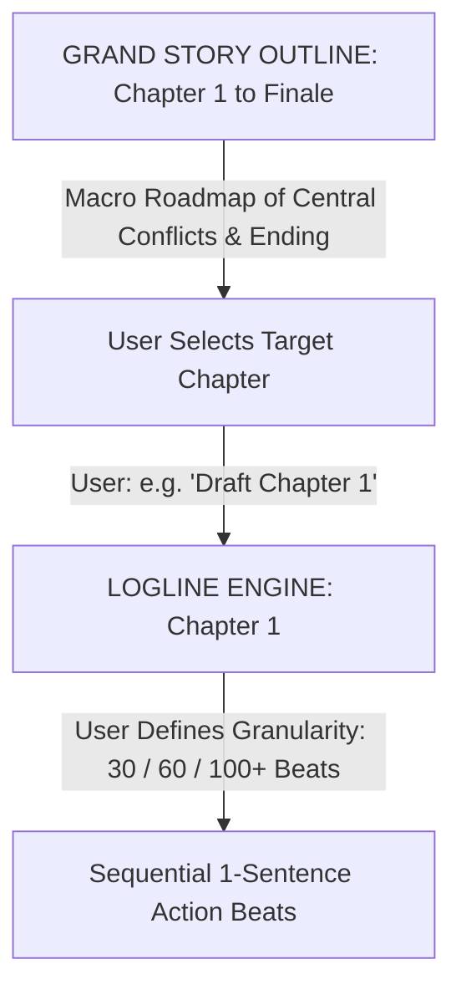
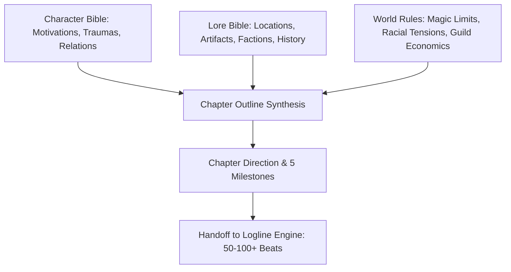

# Story Outline Synthesis Guide (Grand Narrative Roadmap)

This document defines the framework for constructing the **Grand Story Outline**, mapping the overall narrative conflict from **Chapter 1 to the Story Finale** before breaking it down chapter by chapter into micro-loglines.

---

## 1. Hierarchy: Grand Outline vs. Chapter Loglines



- **Story Outline (Macro):** Maps the full narrative scope (Acts 1 through 4, major turning points, escalations, and ultimate resolution).
- **Loglines (Micro per Chapter):** Executed modularly chapter by chapter under full user control. The user dictates granularity (e.g. 30 fast beats, 60 standard beats, or 100+ slowburn beats).

---

## 2. The 3-Way Synthesis Pipeline

Chapter roadmaps are forged by combining three foundational pillars:



### Chapter Integration Formula:
1. **Character Drive:** Pull *Immediate Goals* and *Trauma Triggers* from the [Character Bible](../character_bible_creation/CHARACTER_BIBLE_TEMPLATE.md).
2. **Lore Setting:** Pull *Specific Locations*, *Factions*, or *Artifacts* from the [Lore Bible](../lore_bible_creation/LORE_BIBLE_TEMPLATE.md).
3. **World Friction:** Introduce systemic obstacles (e.g., *Guild Quest Oversupply*, *Mana Depletion*, or *Human vs Beastmen Discrimination*) from [World Rules](../world_rules_creation/WORLD_RULES_TEMPLATE.md).

---

## 3. The 5 Mandatory Chapter Milestones

```text
[5-MILESTONE CHAPTER BLUEPRINT]
├── Milestone A: Opening & Status Quo (~15-20 Beats)
│   └── Sets the initial mood, spatial grounding, and natural character interactions.
├── Milestone B: Inciting Shift / Discovery (~20-25 Beats)
│   └── New information, quest bounties, or unexpected events shifting the trajectory.
├── Milestone C: Midpoint Escalation / Complication (~25-30 Beats)
│   └── Tangible systemic obstacles (guild bureaucracy, social bias, or mana running dry).
├── Milestone D: Decisive Climax / Peak Action (~15-20 Beats)
│   └── High-stakes character decisions or direct physical confrontations.
└── Milestone E: Ending Hook / Cliffhanger (~5-10 Beats)
    └── Unresolved aftermath or cliffhanger driving urgency into the next chapter.
```

---

## 4. Handoff Protocol to the Logline Engine

Once a Chapter Outline is established:
1. The user selects which chapter to write and specifies beat count.
2. The logline engine generates sequential action beats respecting the 5 milestones.
3. The engine is strictly prohibited from bypassing milestones or arbitrarily altering chapter goals.
