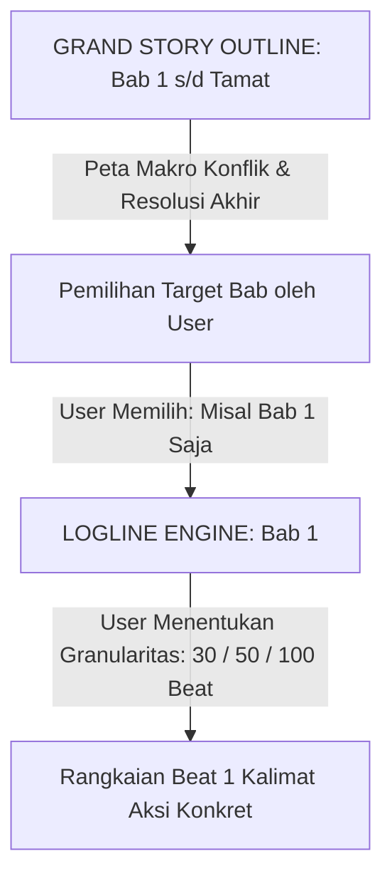

# Panduan & Sintesis Pembuatan Story Outline (Grand Roadmap Awal - Akhir)

Dokumen ini mendefinisikan framework **Story Outline** sebagai peta navigasi makro yang memetakan seluruh perjalanan konflik cerita dari **Bab 1 hingga Akhir Cerita**, sebelum dipecah menjadi mikro-logline bab per bab.

---

## 1. Hierarki Hubungan: Grand Outline vs Bab Logline



- **Story Outline (Makro):** Menggambarkan bentang alur keseluruhan (Bab 1, Bab 2, ... hingga Bab Tamat), eskalasi konflik utama, titik balik cerita, dan klimaks akhir.
- **Logline (Mikro Per-Bab):** Dieksekusi secara mandiri dan fleksibel per bab sesuai arahan user. User memegang kendali penuh atas tingkat kedalaman/detail (misal: 30 beat ringkas, 60 beat sedang, atau 100+ beat slowburn) dalam format 1 kalimat per beat.

---

## 2. Struktur Grand Story Outline (Awal hingga Tamat)

Grand Outline membagi cerita ke dalam 4 babak narasi utama:

1. **Babak 1: Status Quo & Pemicu Utama (Beginning / Setup)**
   - Bab 1 s/d Bab N: Pengenalan dunia, ikatan karakter, dan peristiwa pemantik yang mengubah hidup karakter.
2. **Babak 2: Eskalasi Konflik & Hambatan Dunia (Rising Conflict & World Friction)**
   - Menghadapi birokrasi guild, diskriminasi ras, kelangkaan sumber daya, atau ancaman monster teritorial.
3. **Babak 3: Krisis Terbesar & Titik Balik (Crisis / Dark Night of the Soul)**
   - Puncak benturan moral, kehilangan besar, atau pengkhianatan yang menguji kompas moral karakter.
4. **Babak 4: Konfrontasi Puncak & Resolusi Akhir (Climax & Resolution)**
   - Penyelesaian konflik utama dan penentuan nasib akhir karakter serta dunianya.

---

## 3. Format Ringkasan Bab dalam Grand Outline

Setiap bab dalam Grand Outline dirangkum secara padat (1 paragraf arah) agar mudah ditunjuk oleh user saat ingin mengeksekusi logline:

```text
- Bab 1: [Tujuan & Konflik Pembuka]
- Bab 2: [Pergeseran Arah / Konflik Baru]
- Bab 3: [Eskalasi Tantangan & Rintangan Dunia]
...
- Bab Akhir: [Klimaks & Resolusi Cerita]
```

---

## 4. Protokol Eksekusi Logline Sesuai Kendali User

Ketika user ingin menyusun logline untuk bab tertentu:
1. User memilih bab mana yang ingin dibuat loglinenya (misal: *"Buatkan logline untuk Bab 1 dulu"*).
2. User menentukan tingkat kedalaman/skala beat yang diinginkan (misal: *"Bikin 80 beat yang detail"*).
3. Logline disusun mengikuti target arah bab tersebut dengan format 1 kalimat aksi konkret per beat.
