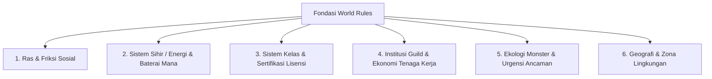

# Panduan & Arsitektur World Rules Creation (Aturan Dasar Semesta)

Dokumen ini mendefinisikan framework pembentukan **World Rules** (Hukum & Dinamika Semesta), mulai dari penentuan basis realisme, opsi fiksi tambahan, hingga sistem fiksi penuh (*Full Fictional RPG World*) yang ditranslasikan secara generik.

---

## 1. Protokol Gate Pertama: Identifikasi Basis Dunia (Tanya User Dulu)

Sebelum merancang aturan dunia, agent **WAJIB menanyakan klasifikasi semesta kepada User**:

```text
[KLARIFIKASI BASIS ATURAN DUNIA]
Mari kita tentukan fondasi realisme dunia yang ingin Anda buat:

1. Opsi A: Full Real-Life (Dunia Nyata Murni)
   - Mengikuti hukum fisika, biologi, geografi, dan sosiologi bumi nyata 100%. 
   - (Jika memilih ini: Tidak ada aturan sihir/monster tambahan yang perlu dibuat).

2. Opsi B: Semi-Real Life + Tambahan Fiksi (Low Fantasy / Sci-Fi Twist)
   - Berbasis dunia nyata, namun memiliki 1-2 variabel fiksi spesifik (contoh: keberadaan satu zat energi baru, teknologi mutasi rahasia, atau fenomena cuaca anomali).

3. Opsi C: Full Fictional / High Fantasy RPG World (Dunia Fiksi Penuh)
   - Memiliki hukum alam independen, keberadaan ras beragam (manusia, beastmen, dll.), sistem sihir/mana terstruktur, institusi guild/pekerjaan, hierarki kelas, dan ekosistem monster.

-> Dari ketiga opsi di atas, jenis fondasi dunia manakah yang ingin Anda gunakan?
```

---

## 2. Arsitektur Pola Semesta Fiksi Generik (*Full Fictional RPG Pattern*)

Berdasarkan pola rancangan sistem dunia mendalam, semesta fiksi terbagi menjadi 6 pilar aturan inti:



### 1. Ras, Anatomi & Ketegangan Sosial (Racial & Social Tensions)
- **Dominasi Ras:** Pembagian kekuasaan politik (misal: manusia mendominasi birokrasi & hukum).
- **Variasi Anatomi & Genetik:** Ras sekunder (misal: ras berkarakter hewan/beastmen dengan keunggulan fisik 1.2x, perkembangan otot cepat, namun ciri instinctual purba mulai memudar akibat modernisasi/overpopulasi).
- **Friksi Sosial & Stereotipe Laten:** Polarisasi antar ras, stereotipe komplotan tertutup, diskriminasi pekerjaan/penginapan di wilayah tertentu, dan variasi regional (ada pulau yang toleran, tirani, atau segregasi ketat).

### 2. Sistem Energi / Sihir Terukur (Measurable Magic System)
- **Sumber Daya Internal:** Mana biologis dalam tubuh yang dapat dilatih batas kapasitasnya (*workout scaling*).
- **Media Penyimpan Eksternal (Mana Battery):** Batu mana / kristal penyerap energi yang berfungsi seperti baterai eksternal (memerlukan regenerasi tubuh setelah diserap, atau diperjualbelikan sebagai komoditas jasa pengisian).
- **Biaya & Keterbatasan Fisik:** Penggunaan melampaui batas (*overload*) menyebabkan kelelahan akut atau gangguan saraf permanen.

### 3. Sistem Kelas & Standar Sertifikasi (Rigorous Class System)
- **3 Arketipe Utama:**
  1. *Vanguard* (Pertahanan & Latihan Fisik Berat: Tank, Warrior, Knight).
  2. *Spellcaster* (Manipulasi Energi & Integrasi Teknologi: Mage, Sorcerer, Enchanter, Healer).
  3. *Striker* (Kelincahan & Presisi: Assassin, Marksman, Rogue, Duelist).
- **Birokrasi Kelas:** Mendapatkan lisensi kelas resmi memerlukan ujian ketat (setara gelar akademik/S1), sayembara khusus, atau turnamen resmi. Pendaftaran kelas terikat pada guild tertentu untuk mencegah pendaftaran ganda (*anti-kutu loncat*).

### 4. Sistem Guild & Dinamika Ekonomi Petualang (Adventurer Labor Market)
- **Dinamika Oversupply:** Pasokan petualang yang berlebih di kota/pulau tertentu menyebabkan penurunan nilai imbalan quest (*labor surplus*).
- **Regulasi Ketat Quest:** Syarat pendaftaran party yang ketat (akibat sejarah kecelakaan masa lalu), restriksi lintas guild, dan sistem penalti hadiah.

### 5. Ekologi Monster & Matriks Ancaman (Threat & Utility Matrix)
- **Tingkat Populasi:** Overpopulasi, seimbang, terancam punah, hingga kategori langka/mitos.
- **Kategori Pemanfaatan vs Bahaya:**
  - *Utility:* Monster yang dipanen untuk bahan masakan, kulit pelindung, atau material alkimia.
  - *Threat:* Bahaya tingkat lokal/kota hingga ancaman bencana global.
  - *Protected:* Spesies yang dilindungi hukum dan dilarang diburu.

---

## 3. Checklist Pre-Finalisasi World Rules

- [ ] Basis dunia (Real vs Semi vs Full Fiction) telah dikonfirmasi oleh user.
- [ ] Batasan sihir memiliki biaya dan risiko fisik yang jelas (*hard limits*).
- [ ] Ketegangan ras dan dinamika sosial memiliki akar historis yang konsisten.
- [ ] Sistem guild dan ekonomi pekerjaan memiliki aturan birokrasi yang logis.
- [ ] Ekologi monster dan zonasi wilayah mendukung alur cerita tanpa kontradiksi.
