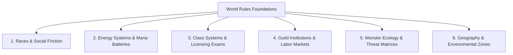

# World Rules Architecture & Framework Guide

This document defines the framework for formulating **World Rules** (Universal Laws & Mechanics), from selecting realism baselines to designing full-scale fictional RPG systems.

---

## 1. Initial Gate Protocol: Clarifying the World Baseline (Ask User First)

Before designing mechanics, the agent **MUST ask the user to specify their universe baseline**:

```text
[WORLD RULES BASELINE CLARIFICATION]
Let's determine the foundational realism of your world:

1. Option A: Full Real-Life (100% Real World)
   - Follows real-world physics, biology, geography, and sociology completely.
   - (If selected: No additional magic systems or monster ecologies are needed).

2. Option B: Semi-Real Life + Fictional Twist (Low Fantasy / Sci-Fi Twist)
   - Based on the real world, but introduces 1-2 specific fictional variables (e.g. a novel energy substance, a secret mutation technology, or an anomalous weather phenomenon).

3. Option C: Full Fictional / High Fantasy RPG World (Complete Fictional Universe)
   - Independent natural laws, diverse races (Humans, Beastmen, etc.), structured magic/mana systems, adventurer guild institutions, rigid class hierarchies, and monster threat matrices.

-> Which of these three options matches your vision for the story?
```

---

## 2. Generic Fictional RPG Architecture (6 Core Pillars)



### 1. Races, Anatomy & Social Friction
- **Racial Dominance:** Political distribution of power (e.g., humans dominating government, bureaucracy, and guild legal structures).
- **Anatomical & Genetic Variants:** Secondary races (e.g., humanoid beastmen with animal traits, 1.2x physical strength, rapid muscle hypertrophy, but extinct ancient instincts due to modern overpopulation).
- **Social Tensions & Latent Stereotypes:** Racial polarization, in-group favoritism, job and accommodation discrimination in certain regions, and geographic variations (tolerant islands, tyrannical regimes, or strict segregation).

### 2. Measurable Energy / Magic System
- **Internal Biological Mana:** Bodily energy accessible to everyone through training (*workout scaling*).
- **External Storage Technology (Mana Battery):** Special mana stones that absorb and store reserve mana like batteries (requiring full user recovery after absorption or commercial recharging services).
- **Hard Limits & Physical Backlash:** Overuse beyond bodily capacity causes acute physical exhaustion, mana fever, or permanent neural damage.

### 3. Class Systems & Formal Licensing Examinations
- **3 Primary Archetypes:**
  1. *Vanguard* (Heavy Physical Conditioning & Defense: Tank, Warrior, Knight).
  2. *Spellcaster* (Energy Manipulation & Tech Integration: Mage, Sorcerer, Enchanter, Healer).
  3. *Striker* (Agility, Speed & Precision: Assassin, Marksman, Rogue, Duelist).
- **Class Bureaucracy:** Official class licensing is formalized like a university degree (S1 equivalent), requiring rigorous exams, tournaments, or royal contests. Class registration is bound to specific guilds to prevent multi-guild hopping.

### 4. Guild Institutions & Labor Market Economics
- **Labor Oversupply:** Adventurer oversupply in major metropolitan centers driving down quest rewards (*labor surplus*).
- **Strict Quest Regulations:** Mandatory party registration (born from past disaster histories), cross-guild restrictions, and reward penalties.

### 5. Monster Ecology & Threat Matrices
- **Population Tiers:** Overpopulated, balanced, endangered, or legendary/mythical.
- **Utility vs Threat Matrix:**
  - *Utility:* Harvestable for cooking ingredients, leather armor, or alchemy reagents.
  - *Threat:* Ranging from localized hazards to city-destroying disaster crises.
  - *Protected:* Sacred creatures legally shielded from hunting.

---

## 3. Pre-Finalization Checklist

- [ ] World baseline (Real vs Semi vs Full Fiction) confirmed by user.
- [ ] Magic system has strict physical costs, limits, and backlash risks.
- [ ] Racial tensions and social friction have logical historical foundations.
- [ ] Guild economics and class bureaucracy create natural narrative tension.
- [ ] Monster ecology and threat classifications support the plot without contradictions.
