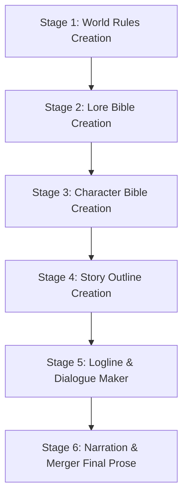

# 📖 duidwidev-novel: Serialized Novel & Slowburn Story Creation Skill

> **Author:** `duidwidev`  
> **Target Engine:** Google Antigravity IDE / Gemini Agent Custom Skills  
> **Skill Name:** `duidwidev-novel`

A multi-stage, modular system for writing serialized slowburn novels and complex worldbuilding: spanning from universal world rules, curated lore bibles, 6-pillar character branding, grand narrative outlines, and mood-tracked micro-loglines with fluid dialogues, to grounded, plain-language final prose free of AI slop.

---

## 🗺️ Master Pipeline (6 Sequential Stages)



1. **🏛️ World Rules Creation (`world_rules_creation/`):**  
   Define realism baselines (Full Real-Life, Semi-Real + Fiction, or Full Fictional RPG), biological internal mana & external mana-battery storage crystals, social & racial tensions (Human vs. Beastmen), 3-archetype class licensing (*Vanguard, Spellcaster, Striker*), formal examination bureaucracy, and guild quest labor markets.

2. **📜 Lore Bible Creation (`lore_bible_creation/`):**  
   Curated canon repository for *Items, Entities, Places, Rules, Social Relations, and History* governed by the **User Curation Gate** (mandatory user permission before canonizing any lore) and authentic single-word/Latin-root naming conventions (*Irthiniris, Valdris*).

3. **👤 Character Bible Creation (`character_bible_creation/`):**  
   Comprehensive character branding built across 6 core pillars (*Non-Cringe Iconic Lines, Micro-Habits, Visual Anchors, Dynamic Trauma Triggers, Evolving Story Motivations, & Moral Red Lines*) guided by an interactive multi-choice interview protocol.

4. **🗺️ Story Outline Creation (`story_outline_creation/`):**  
   Grand Narrative Roadmap from Chapter 1 to the Story Finale (4 Narrative Acts & 5 Mandatory Chapter Milestones A–E) serving as the overarching direction for loglines.

5. **🎬 Logline & Dialogue Maker (`logline_skill_framework/` & `dialogue_maker/`):**  
   Flexible chapter-by-chapter micro-beat drafting (30–100+ beats), 8 standardized mood tokens (`CALM`, `WARMTH`, `UNEASE`, `TENSE`, `PANIC`, `RELIEF`, `MELANCHOLY`, `TRIUMPH`), anti-mood whiplash anomaly audits (*Sandwich Anomaly*), and fluid dialogue integration (meaningful small talk, banter, and creature non-verbal lines).

6. **✍️ Narration & Merger (`narration_and_merger/`):**  
   Seamless fusion of logline actions, spoken dialogue, and dialogue tags into complete novel paragraphs. Enforces strict diction filters: **plain, grounded language, zero purple prose, zero sugar-coating, and complete elimination of obscure/archaic verbs**. Supports modular chapter-by-chapter execution.

---

## 📦 Repository Structure

```text
├── .agents/skills/duidwidev-novel/  ──► Official Antigravity Custom Skill package
│   ├── SKILL.md                     ──► Skill entry-point & YAML frontmatter
│   ├── references/                  ──► 10 Deep guides & regulatory specifications
│   ├── resources/                   ──► 6 Ready-to-use master templates
│   └── evaluations/                 ──► 8 Scorecards & stress-test rubrics
│
├── MASTER_WORKFLOW.md               ──► End-to-end master execution manual
├── world_rules_creation/            ──► Universal world mechanics & society rules
├── lore_bible_creation/             ──► Canon lore specifications & user curation
├── character_bible_creation/        ──► Character profiles & 6 branding pillars
├── story_outline_creation/          ──► Grand narrative roadmap & chapter direction
├── logline_skill_framework/         ──► Slowburn micro-loglines & mood tracking
├── dialogue_maker/                  ──► Fluid dialogue integration & natural small talk
└── narration_and_merger/            ──► Plain-language final novel prose merger
```

---

## 💻 How to Install in Antigravity IDE

### Option 1: Global Installation (All Projects)
Copy the `.agents/skills/duidwidev-novel/` directory into your global Antigravity configuration directory:
```bash
# Windows PowerShell
Copy-Item -Path ".agents\skills\duidwidev-novel" -Destination "$HOME\.gemini\config\skills\duidwidev-novel" -Recurse -Force
```

### Option 2: Workspace Installation (Current Project Only)
Simply place the skill folder in your project workspace root:
```text
<workspace-root>/.agents/skills/duidwidev-novel/
```

---

## 🛡️ The 5 Golden Rules of duidwidev-novel

1. **User Curation Gate:** The agent must ALWAYS ask for user permission before adding any new named character or canonizing any lore bible entry.
2. **Authentic Naming:** Ban generic compound words (*Eastview, Blackclaw, Shadowblade*); enforce distinct 1-word or Latin-root names (*Irthiniris, Valdris*).
3. **Plain & Grounded Diction:** Descriptions must focus on physical, tangible actions without empty fancy vocabulary or pretentious purple prose.
4. **Meaningful Small Talk:** Casual, everyday character banter is an essential requirement for building organic chemistry and intimacy.
5. **Modular Chapter-by-Chapter Execution:** Loglines and prose conversion can be executed modularly chapter by chapter on demand.

---

*Authored by **duidwidev** for the Google Antigravity ecosystem.*
