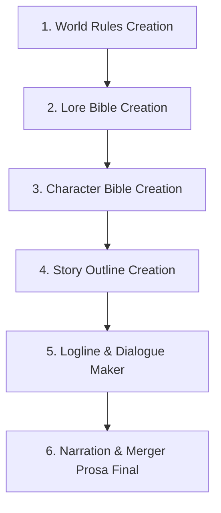

# 📖 duidwidev-novel: Serialized Novel & Slowburn Story Creation Skill

> **Author:** `duidwidev`  
> **Target Engine:** Google Antigravity IDE / Gemini Agent Custom Skills  
> **Skill Name:** `duidwidev-novel`

Sistem terpadu pembuatan novel serial slowburn multi-tahap: mulai dari perancangan aturan semesta, kanon dunia terkurasi, profil karakter 6 pilar branding, grand outline makro, mikro-logline berdialog, hingga konversi narasi prosa novel yang jernih, membumi, dan bebas *AI-slop*.

---

## 🗺️ Master Pipeline (6 Tahap Berurutan)



1. **🏛️ World Rules Creation (`world_rules_creation/`):**  
   Menentukan basis realisme (Real-Life vs Semi-Real vs Full Fictional RPG), sistem sihir biologis & baterai mana, ras & friksi sosial (manusia vs beastmen), 3 arketipe kelas (*Vanguard, Spellcaster, Striker*), birokrasi ujian S1, dan ekonomi quest guild.

2. **📜 Lore Bible Creation (`lore_bible_creation/`):**  
   Repositori kanon dunia (*Item, Entitas, Tempat, Rules, Sejarah*) dengan aturan mutlak kurasi persetujuan user (*User Curation Gate*) dan konvensi penamaan otentik 1 kata / Latin-root (*Irthiniris, Valdris*).

3. **👤 Character Bible Creation (`character_bible_creation/`):**  
   Profil karakter dengan 6 pilar branding kuat (*Iconic lines non-cringe, Micro-habits, Visual anchor, Trauma triggers, Dynamic motivation, & Moral compass*) melalui panduan wawancara multi-pilihan (*Multi-Choice*).

4. **🗺️ Story Outline Creation (`story_outline_creation/`):**  
   Grand Roadmap cerita dari Bab 1 hingga Akhir Cerita (4 Babak Narasi & 5 Milestones A-E per bab) yang menjadi kompas arah (*direction*) bagi penulisan logline.

5. **🎬 Logline & Dialogue Maker (`logline_skill_framework/` & `dialogue_maker/`):**  
   Eksekusi mikro-beat per bab yang fleksibel (30–100+ beat), menggunakan 8 token mood baku (`CALM`, `WARMTH`, `UNEASE`, `TENSE`, `PANIC`, `RELIEF`, `MELANCHOLY`, `TRIUMPH`), audit anti-anomali suasana (*Sandwich Anomaly*), dan penyisipan dialog luwes (termasuk basa-basi akrab & bahasa non-verbal naga/makhluk).

6. **✍️ Narration & Merger (`narration_and_merger/`):**  
   Penggabungan aksi logline, dialog, dan dialog tag menjadi alinea novel utuh. Menerapkan filter bahasa ketat: **bahasa lugas, mudah dipahami, zero purple prose, zero sugar-coating, dan bebas dari kata kerja sastra berat/arkais**. Dapat dieksekusi secara modular bab per bab.

---

## 📦 Struktur Repositori

```text
├── .agents/skills/duidwidev-novel/  ──► Paket Custom Skill resmi Antigravity
│   ├── SKILL.md                     ──► Entry-point instruksi skill
│   ├── references/                  ──► 10 Dokumen panduan & regulasi mendalam
│   ├── resources/                   ──► 6 Template master siap pakai
│   └── evaluations/                 ──► 8 Lembar scorecard & stress-test
│
├── MASTER_WORKFLOW.md               ──► Panduan alur eksekusi master end-to-end
├── world_rules_creation/            ──► Modul perancangan aturan semesta
├── lore_bible_creation/             ──► Modul kanon spesifikasi dunia & kurasi
├── character_bible_creation/        ──► Modul profil karakter & 6 pilar branding
├── story_outline_creation/          ──► Modul peta alur babak & chapter direction
├── logline_skill_framework/         ──► Modul mikro-logline slowburn & audit mood
├── dialogue_maker/                  ──► Modul dialog luwes & basa-basi alami
└── narration_and_merger/            ──► Modul konversi narasi prosa novel final
```

---

## 💻 Cara Pemasangan Skill di Antigravity IDE

### Opsi 1: Pemasangan Global (Semua Proyek)
Salin folder `.agents/skills/duidwidev-novel/` ke direktori konfigurasi global:
```bash
# Windows
cp -r .agents/skills/duidwidev-novel ~/.gemini/config/skills/
```

### Opsi 2: Pemasangan Workspace (Proyek Saat Ini)
Cukup tempatkan folder skill pada direktori proyek Anda di:
```text
<workspace-root>/.agents/skills/duidwidev-novel/
```

---

## 🛡️ 5 Golden Rules duidwidev-novel

1. **User Curation Gate:** Wajib meminta izin user sebelum mendaftarkan karakter bernama baru atau entri Lore Bible kanon.
2. **Authentic Naming:** Selalu gunakan nama distingtif 1 kata / Latin-root (*Irthiniris*), bukan nama generik gabungan kata (*Eastview/Blackclaw*).
3. **Plain & Grounded Diction:** Deskripsi fokus pada aksi fisik nyata dan fakta lingkungan tanpa kata-kata *fancy* kosong atau puitis berlebihan.
4. **Meaningful Small Talk:** Basa-basi santai adalah kebutuhan nyata untuk memperkuat *bonding & chemistry* karakter.
5. **Modular Chapter-by-Chapter Execution:** Logline dan narasi prosa dieksekusi bab per bab secara bertahap sesuai kendali penuh user.

---

*Dikembangkan oleh **duidwidev** untuk ekosistem Google Antigravity.*
